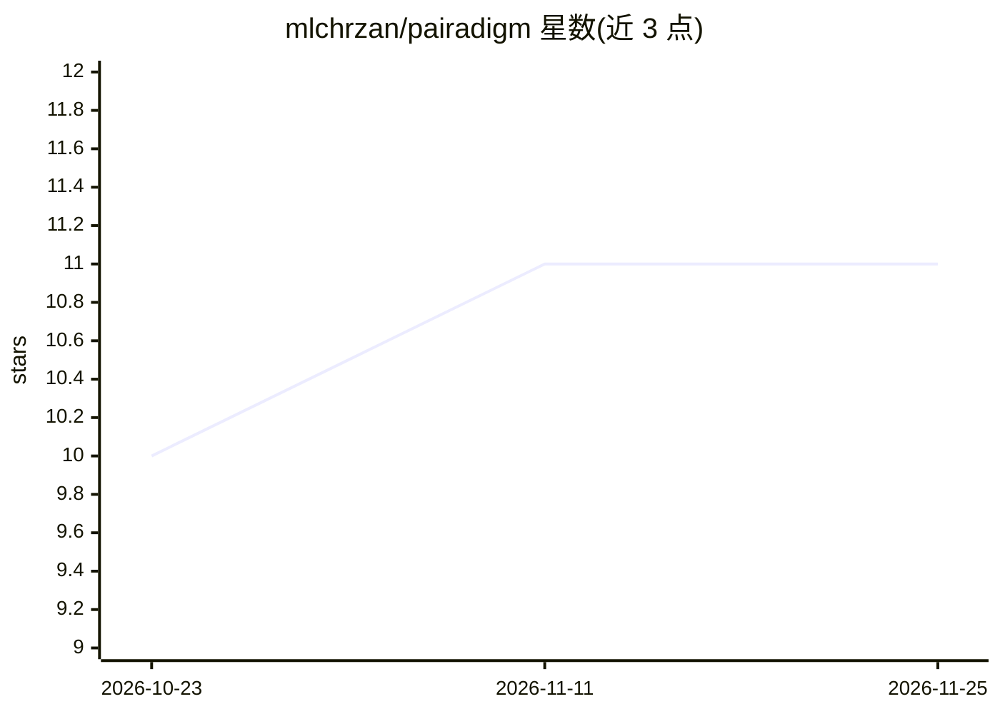

# mlchrzan/pairadigm

⭐ 11 · Jupyter Notebook · Apache-2.0 · 推送 2026-09-30 · [GitHub](https://github.com/mlchrzan/pairadigm) · [官网](https://github.com/mlchrzan/pairadigm) · 个人维护

**科研人员的 LLM 成对标注与构念测量 Python 库**

pairadigm 是一个 Python 库，实现 Concept-Guided Chain-of-Thought（CGCoT）方法：先用分步提示对文本做逐层分解，再由 LLM 生成成对比较，通过 Bradley-Terry 模型将比较结果转为连续分数；支持用少量人工标注验证 LLM 标注，验证后可扩展到更大样本，并提供微调 encoder 奖励模型（如 ModernBERT）的流水线。支持 Google Gemini、OpenAI、Anthropic、Ollama 本地模型与 Hugging Face 模型，包含 API 成本估算、速率限制、自定义评分函数与多模型并行配置。面向研究场景的文本构念测量。

## 筛选速览

| 维度 | 判定 | 备注 |
|---|---|---|
| AI 角色 | `ai-native` | 本体是模型或模型工具 |
| 许可风险 | `permissive` | Apache-2.0 |
| 部署形态 | `library` | 以包/库形式分发 |
| 模型依赖 | local-ok | 支持本地模型 |
| 硬件要求 | — | 无带数字的原话,不猜 |
| 安装摩擦 | `low` | 无编译、无系统依赖或容器化 |
| 成熟度 | — | 结构信号不足 |

## 能力要点

- CGCoT 分步提示生成文本分解并产生成对比较
- Bradley-Terry 模型将比较转为连续分数，支持 Davidson 评分
- 少量人工标注验证 LLM 标注（AltTest 等指标）
- API 成本估算、速率限制与保存/加载分析（parquet 存储）

## 适用场景

- 对文本数据构建连续测量量表并生成成对比较
- 用少量人工标注验证 LLM 标注的可靠性后再扩展标注规模
- 将成对比较结果微调为奖励模型并迁移到其他数据集

## 场景标签

`科研工具` `微调` · 领域:学习与行业

## 证据(README 行号)

> L3: `pairadigm` is a Python library designed to streamline the creation of high-quality, continuous measurement scales f
> L84: ### Validating Against Human Annotations
> L189: - Dawid-Skene item ground truth estimation with and without LLM annotators (NOT STARTED)

## 星数曲线

2026-10-23 10 → 2026-11-25 11（+1）

---
*卡片 v1 · prompt 1.4 · 生成 2026-11-18 · 置信度 high · 依据 README sha `d733fc824ef2` · [字段定义](../../DATASET.md)*
