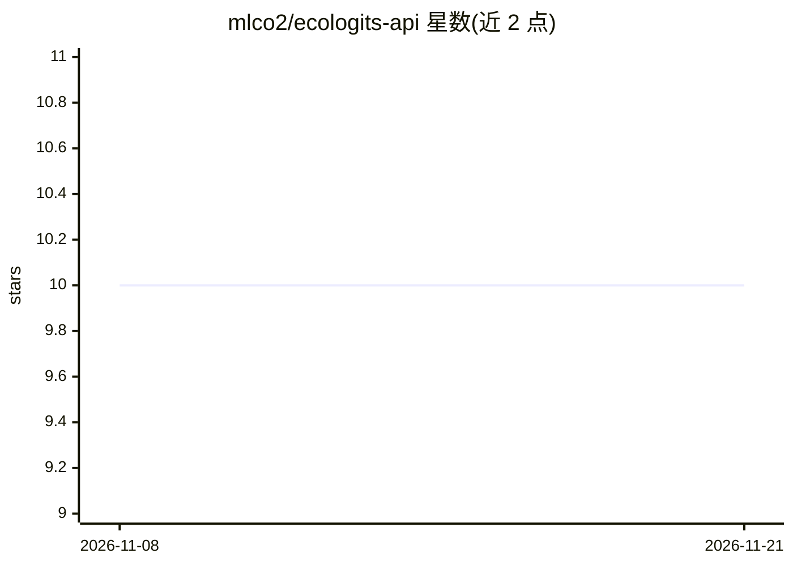

# mlco2/ecologits-api

⭐ 10 · Python · AGPL-3.0 · 推送 2026-11-13 · [GitHub](https://github.com/mlco2/ecologits-api) · [官网](https://api.ecologits.ai/docs) · 组织维护

**估算 LLM 生成请求环境影响的 API**

由 Code Carbon 非营利组织维护的 EcoLogits 系列中的 HTTP API，基于 EcoLogits 0.11.3 库，通过 /v1beta 路由提供估算与模型目录接口：传入 provider 名、模型名、输出 token 数、请求延迟与电网区域，返回该次 LLM 生成请求的环境影响估算。提供 GET /health 健康检查，可本地以 Python 3.11+ 与 uv 运行，也可用发布的 ghcr.io 镜像或自行构建 Docker 镜像部署，另附企业自建基础设施的部署指南；官方文档站为 api.ecologits.ai/docs。

## 筛选速览

| 维度 | 判定 | 备注 |
|---|---|---|
| AI 角色 | `ai-ecosystem` | LLM/agent 周边工具 |
| 许可风险 | `viral` | AGPL-3.0 |
| 部署形态 | `self-host` | docker 或自建部署 |
| 模型依赖 | — | README 未给出锁定关系 |
| 硬件要求 | — | 无带数字的原话,不猜 |
| 安装摩擦 | `low` | 无编译、无系统依赖或容器化 |
| 成熟度 | — | 结构信号不足 |

## 能力要点

- /v1beta/estimations 接口按 provider/模型/token 数/延迟/电网区域估算环境影响
- 基于 EcoLogits 0.11.3，含估算与模型目录路由
- 提供发布镜像 ghcr.io/mlco2/ecologits-api 与自行构建两种 Docker 路径，支持 amd64/arm64
- 非 root 用户（UID/GID 10001）运行，/health 轻量健康检查可作 HTTP probe

## 适用场景

- 统计我们调用 GPT-4o-mini 等模型产生的碳排放估算
- 在企业内部署一套 LLM 环境影响估算服务
- 为面向用户的工具集成生态足迹查询接口

## 场景标签

 · 领域:绿色计算/LLM 基础设施

## 证据(README 行号)

> L5: An API to estimate the environmental impacts of LLM generation requests.
> L61: Use the `/v1beta/estimations` endpoint to estimate the environmental impacts of your LLM generation requests by pro

## 星数曲线

2026-11-08 10 → 2026-11-21 10（+0）

---
*卡片 v1 · prompt 1.4 · 生成 2026-11-19 · 置信度 mid · 依据 README sha `3073ce8a0af0` · [字段定义](../../DATASET.md)*
