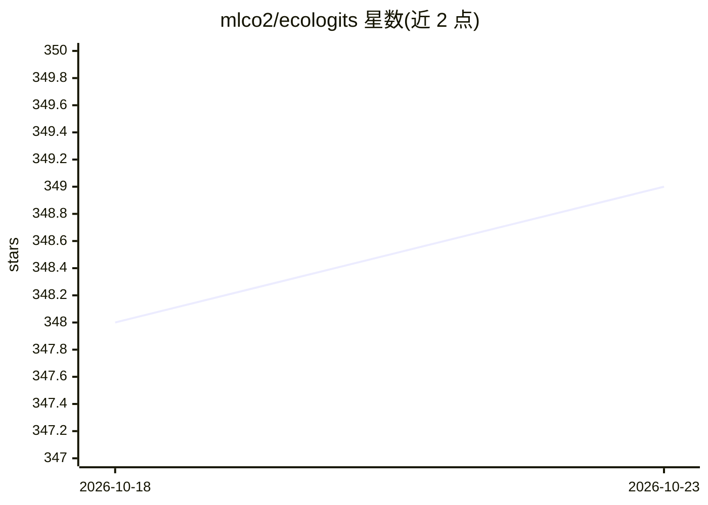

# mlco2/ecologits

⭐ 349 · Python · MPL-2.0 · 推送 2026-10-14 · [GitHub](https://github.com/mlco2/ecologits) · [官网](https://ecologits.ai/) · 组织维护

**追踪生成式 AI API 调用能耗与环境足迹的 Python 库**

EcoLogits 是一个 Python 库，通过包装主流生成式 AI 提供商的 API 客户端，追踪每次调用的能耗与环境足迹（能源消耗与环境影响）。以 pip 安装，按提供商安装可选集成（anthropic、cohere、google-genai、huggingface-hub、mistralai、openai），用法为在 OpenAI 等客户端初始化时注入 EcoLogits。属于 Code Carbon 非营利组织，由志愿者构建并有赞助商支持；MPL-2.0 许可。另有同生态的 EcoLogits API、EcoLogits.js、Calculator 与面向本地算力的 CodeCarbon。限制：面向 API 调用场景，本地算力需用 CodeCarbon。

## 筛选速览

| 维度 | 判定 | 备注 |
|---|---|---|
| AI 角色 | `ai-ecosystem` | LLM/agent 周边工具 |
| 许可风险 | `permissive` | MPL-2.0 |
| 部署形态 | `library` | 以包/库形式分发 |
| 模型依赖 | locked-api |  |
| 硬件要求 | — | 无带数字的原话,不猜 |
| 安装摩擦 | `low` | 无编译、无系统依赖或容器化 |
| 成熟度 | — | 结构信号不足 |

## 能力要点

- 包装生成式 AI 提供商 SDK 客户端以追踪调用的能耗与环境足迹
- 支持 6 个提供商的可选集成（anthropic/cohere/google-genai/huggingface-hub/mistralai/openai）
- 由 Code Carbon 非营利组织维护，MPL-2.0 许可
- 有社区构建的衍生集成（Claude Code 状态栏、VS Code 状态栏）

## 适用场景

- 我为应用中的 LLM API 调用估算碳排放与能耗
- 我要在 OpenAI/Anthropic 等客户端中无侵入式接入环境足迹追踪
- 我需要报告企业 AI 使用的可持续性指标

## 场景标签

`LLM 可观测性` · 领域:评测与运维

## 证据(README 行号)

> L3: 🌱 **EcoLogits** tracks the energy consumption and environmental impacts of using generative AI models through APIs.
> L24: For integration with a specific provider, use `pip install ecologits[openai]`. We are currently supporting the foll

## 星数曲线

2026-10-18 348 → 2026-10-23 349（+1）

---
*卡片 v1 · prompt 1.4 · 生成 2026-10-22 · 置信度 high · 依据 README sha `6db59935fa94` · [字段定义](../../DATASET.md)*
