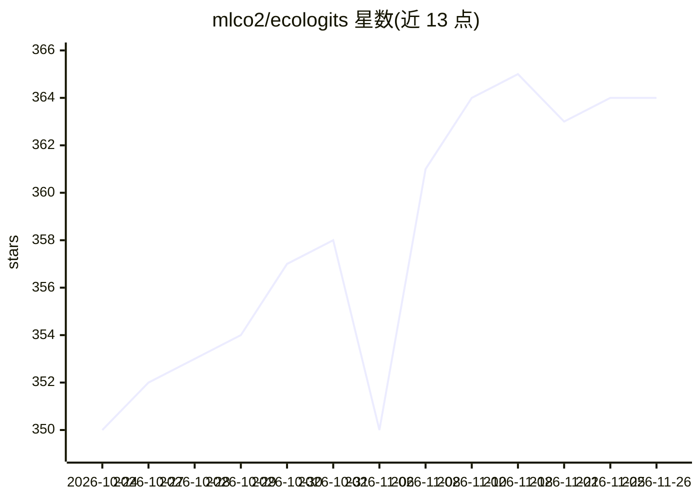

# mlco2/ecologits

⭐ 364 · Python · MPL-2.0 · 推送 2026-11-25 · [GitHub](https://github.com/mlco2/ecologits) · [官网](https://ecologits.ai/) · 组织维护

**为通过 API 调用生成式 AI 的开发者估算能耗与环境足迹**

Python 库，追踪经 API 使用生成式 AI 模型时的能耗与环境影响。以 pip 安装后可叠加在 OpenAI 等客户端调用上，估算每次请求的能耗与排放指标。支持与特定 provider 集成的可选安装项，当前覆盖 anthropic、cohere、google-genai、huggingface-hub、mistralai、openai。隶属于 Code Carbon 非营利组织，由志愿者维护并有赞助方支持；本地计算场景则指向同组织的 CodeCarbon。

## 筛选速览

| 维度 | 判定 | 备注 |
|---|---|---|
| AI 角色 | `ai-ecosystem` | LLM/agent 周边工具 |
| 许可风险 | `permissive` | MPL-2.0 |
| 部署形态 | `library` | 以包/库形式分发 |
| 模型依赖 | locked-api |  |
| 硬件要求 | — | 无带数字的原话,不猜 |
| 安装摩擦 | `low` | 无编译、无系统依赖或容器化 |
| 成熟度 | — | 结构信号不足 |

## 能力要点

- 以 pip 库形式追踪 API 调用生成式 AI 的能耗与环境影响
- 提供按 provider 的可选集成安装（openai/anthropic/cohere 等）
- 提供配套工具：EcoLogits API、EcoLogits.js、Calculator
- 隶属 Code Carbon 非营利组织，由志愿者维护

## 适用场景

- 在调用生成式 AI API 的应用中估算每次请求的能耗
- 统计团队使用大模型 API 的环境足迹
- 本地部署场景改用同组织 CodeCarbon 统计排放

## 场景标签

`LLM 可观测性` · 领域:评测与运维

## 证据(README 行号)

> L3: 🌱 **EcoLogits** tracks the energy consumption and environmental impacts of using generative AI models through APIs.
> L24: For integration with a specific provider, use `pip install ecologits[openai]`. We are currently supporting the foll

## 星数曲线

2026-10-24 350 → 2026-11-26 364（+14）

---
*卡片 v1 · prompt 1.4 · 生成 2026-11-26 · 置信度 high · 依据 README sha `0fd2da2d3949` · [字段定义](../../DATASET.md)*
