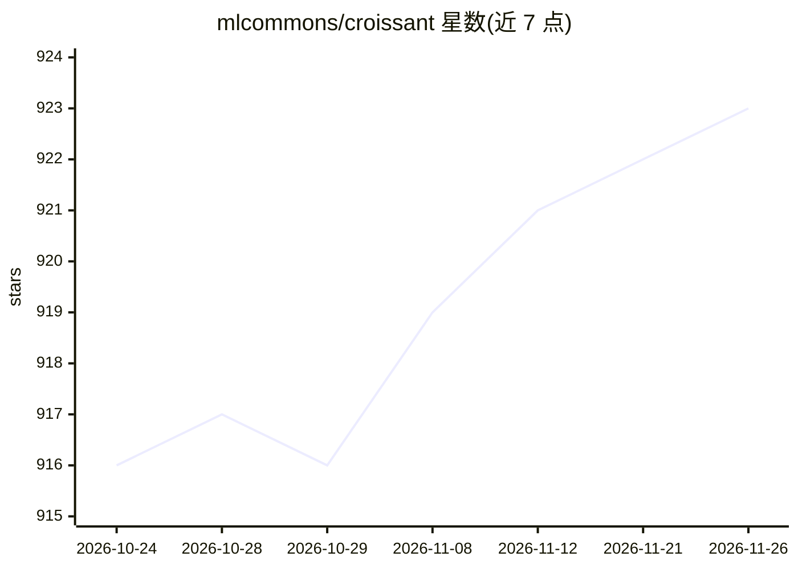

# mlcommons/croissant

⭐ 923 · Jupyter Notebook · Apache-2.0 · 推送 2026-11-16 · [GitHub](https://github.com/mlcommons/croissant) · [官网](https://mlcommons.org/croissant) · 组织维护

**ML 数据集元数据标准格式及读取库 mlcroissant**

由 MLCommons 数据集工作组社区开发的机器学习数据集高层格式，将元数据、资源文件描述、数据结构与默认 ML 语义四层合并为单一 JSON-LD 文件，基于 schema.org Dataset 词表构建。提供 Python 库 mlcroissant（要求 Python 3.10+）加载 Croissant 文件并迭代数据集记录，附格式规范、验证器与示例数据集。Kaggle、OpenML、Hugging Face、TFDS、CKAN、Dataverse 等平台提供导出或嵌入支持。实现采用 Apache 2 许可，规范采用 CC BY-ND 4.0。

## 筛选速览

| 维度 | 判定 | 备注 |
|---|---|---|
| AI 角色 | `ai-knowledge` | 知识聚合/清单类 |
| 许可风险 | `permissive` | Apache-2.0 |
| 部署形态 | `library` | 以包/库形式分发 |
| 模型依赖 | — | README 未给出锁定关系 |
| 硬件要求 | — | 无带数字的原话,不猜 |
| 安装摩擦 | `low` | 无编译、无系统依赖或容器化 |
| 成熟度 | `idea` | |

## 能力要点

- 四层结构：元数据、资源、结构、ML 语义合并为单一文件
- 基于 schema.org Dataset 词表的 JSON-LD 格式
- pip 安装 mlcroissant 库，可加载远程 Croissant 文件并读取记录
- Kaggle/Hugging Face/OpenML/TFDS 等平台集成

## 适用场景

- 为 ML 数据集发布统一的标准元数据描述
- 用 mlcroissant 加载 Hugging Face 等平台数据集
- 构建工具来查找、理解与改进 ML 数据集

## 场景标签

 · 领域:机器学习数据集/标准规范

## 证据(README 行号)

> L8: Croissant 🥐 is a high-level format for machine learning datasets that combines metadata, resource file descriptions,
> L100: Croissant is being developed by the community as a Task Force of the MLCommons Association Datasets Working Group.

## 星数曲线

2026-10-24 916 → 2026-11-26 923（+7）

---
*卡片 v1 · prompt 1.4 · 生成 2026-11-24 · 置信度 high · 依据 README sha `9b5b445ffa31` · [字段定义](../../DATASET.md)*
