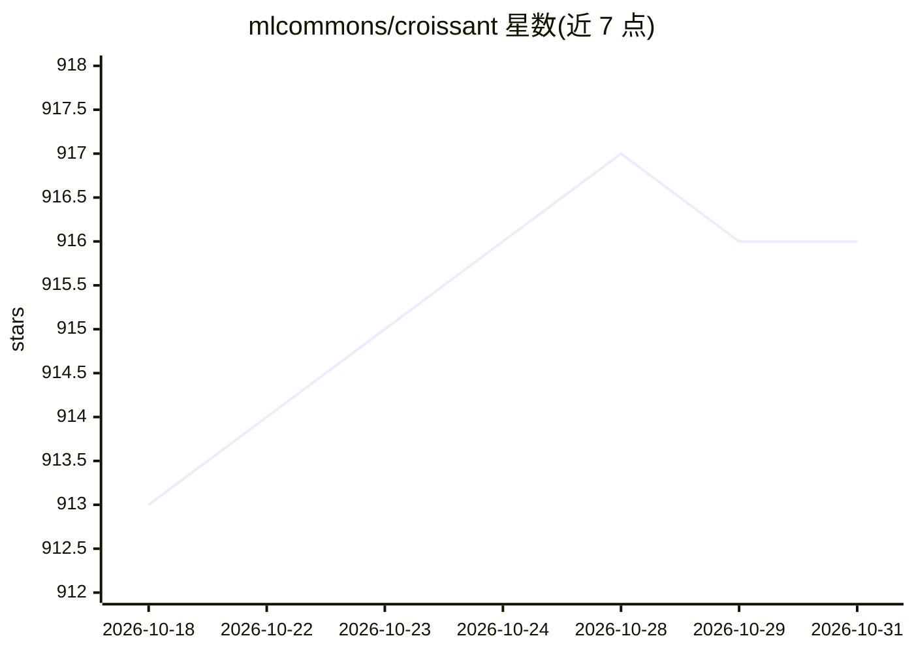

# mlcommons/croissant

⭐ 916 · HTML · Apache-2.0 · 推送 2026-10-05 · [GitHub](https://github.com/mlcommons/croissant) · [官网](https://mlcommons.org/croissant) · 组织维护

**面向 ML 数据集的高层元数据格式及 Python 读取库**

Croissant 是一种基于 schema.org Dataset 词汇表的机器学习数据集高层格式，将元数据、资源文件描述、数据结构与默认 ML 语义合并到单个 JSON-LD 文件中，使现有数据集更易被发现、使用和被工具支持。提供官方 Python 实现 mlcroissant（需 Python 3.10+），可加载本地或远程 Croissant 文件并按 RecordSet 读取记录，接入 TensorFlow/JAX/PyTorch 工作流。由 MLCommons Datasets 工作组下的社区任务组治理，代码 Apache 2 许可，规范采用 CC BY-ND 4.0。

## 筛选速览

| 维度 | 判定 | 备注 |
|---|---|---|
| AI 角色 | `ai-ecosystem` | LLM/agent 周边工具 |
| 许可风险 | `permissive` | Apache-2.0 |
| 部署形态 | `library` | 以包/库形式分发 |
| 模型依赖 | — | README 未给出锁定关系 |
| 硬件要求 | — | 无带数字的原话,不猜 |
| 安装摩擦 | `low` | 无编译、无系统依赖或容器化 |
| 成熟度 | `idea` | |

## 能力要点

- 四层结构：元数据、资源、结构、ML 语义合并为单文件
- Python 库 mlcroissant 支持加载并读取本地/远程数据集记录
- 构建于 schema.org Dataset 词汇表（JSON-LD）
- Google Datasets Search、Kaggle、Hugging Face、OpenML、TFDS、CKAN、Dataverse 等平台已集成

## 适用场景

- 用统一格式描述和发现 ML 数据集
- 在 TensorFlow/JAX/PyTorch 工作流中加载 Croissant 格式数据
- 数据平台以标准格式发布和交换数据集元数据

## 场景标签

 · 领域:机器学习数据基础设施

## 证据(README 行号)

> L8: Croissant 🥐 is a high-level format for machine learning datasets that combines metadata, resource file descriptions,
> L93: - TFDS has a `CroissantBuilder` to transform any JSON-LD file into a TFDS dataset, which makes it possible to load 

## 星数曲线

2026-10-18 913 → 2026-10-31 916（+3）

---
*卡片 v1 · prompt 1.4 · 生成 2026-10-21 · 置信度 high · 依据 README sha `085fd26540f3` · [字段定义](../../DATASET.md)*
