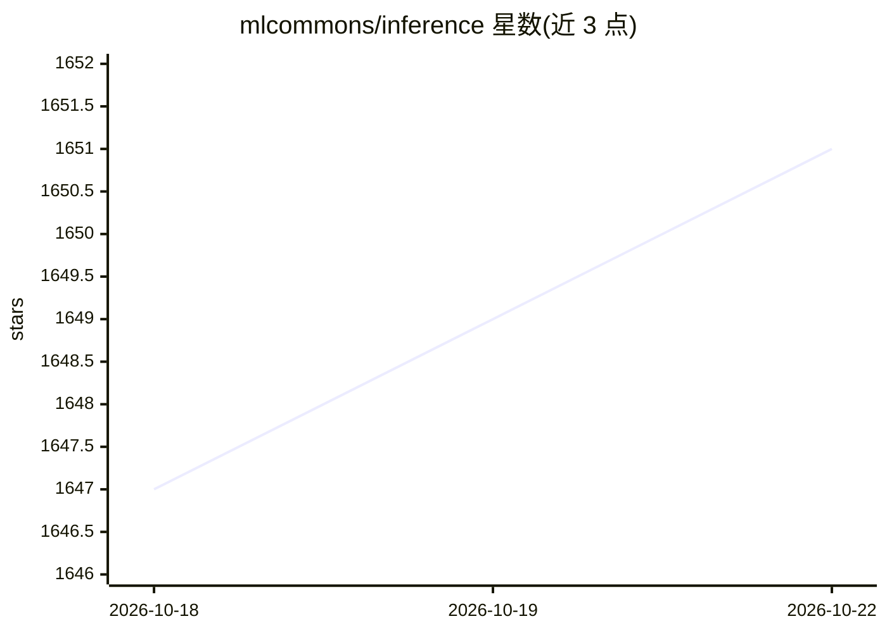

# mlcommons/inference

⭐ 1,652 · Python · Apache-2.0 · 推送 2026-09-16 · [GitHub](https://github.com/mlcommons/inference) · [官网](https://mlcommons.org/en/groups/inference) · 组织维护

**MLPerf 推理基准套件参考实现：测量系统运行模型的速度**

MLCommons 维护的 MLPerf Inference 基准套件参考实现，用于测量各类系统在边缘与数据中心部署场景下运行模型的速度。覆盖 v3.1 至 v6.1 多个版本，模型包括 resnet50、bert、llama2-70b、deepseek-r1、whisper、stable-diffusion-xl、GPT-OSS、Qwen3-VL 等，参考实现基于 pytorch、tensorflow、onnx、tvm、ncnn 框架，提交者可使用自有框架。附基准论文引用与各版本提交规则说明。

## 筛选速览

| 维度 | 判定 | 备注 |
|---|---|---|
| AI 角色 | `ai-ecosystem` | LLM/agent 周边工具 |
| 许可风险 | `permissive` | Apache-2.0 |
| 部署形态 | `None` |  |
| 模型依赖 | — | README 未给出锁定关系 |
| 硬件要求 | — | 无带数字的原话,不猜 |
| 安装摩擦 | `low` | 无编译、无系统依赖或容器化 |
| 成熟度 | — | 结构信号不足 |

## 能力要点

- 覆盖分类、检测、LLM、推荐、语音、文生图/视频、多模态等多类模型基准
- 参考实现支持 pytorch/tensorflow/onnx/tvm/ncnn，提交者可换用自有框架
- 按 edge 与 datacenter 类别组织，含功耗提交规则（SPEC PTD）
- 提供基准论文引用与逐版本提交截止日期与复现说明

## 适用场景

- 提交方为 MLPerf Inference 各版本提交准备与复现基准结果
- 系统/硬件厂商测量模型推理性能
- 研究者引用 MLPerf 论文进行推理性能对比实验

## 场景标签

`模型评测` · 领域:评测与运维

## 证据(README 行号)

> L2: MLPerf Inference is a benchmark suite for measuring how fast systems can run models in a variety of deployment scena
> L21: | model | reference app | framework | dataset | category

## 星数曲线

2026-10-18 1,647 → 2026-10-22 1,651（+4）

---
*卡片 v1 · prompt 1.4 · 生成 2026-10-21 · 置信度 high · 依据 README sha `6353c9dc54d9` · [字段定义](../../DATASET.md)*
