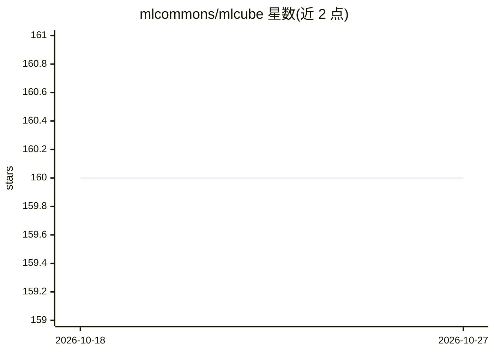

# mlcommons/mlcube

⭐ 160 · Python · Apache-2.0 · 推送 2025-11-26 · [GitHub](https://github.com/mlcommons/mlcube) · [官网](https://docs.mlcommons.org/mlcube/) · 组织维护

**让 ML 模型跨环境可移植可复现的容器化接口规范与运行器**

MLCommons 维护的开放项目，为机器学习软件定义一组通用约定：将 ML 模型打包进 Docker 等容器，提供一致接口，使同一代码可在本地机器、各大云平台与 Kubernetes 集群中运行。官方提供各环境的开源 runner，将训练或运行 MLCube 化模型简化为单条命令。面向研究者分享模型、开发者实验多模型及软件公司构建模型基础设施，通过 pip 从 PyPI 安装，Apache 2.0 许可。项目自述仍处于早期阶段、活跃开发中。

## 筛选速览

| 维度 | 判定 | 备注 |
|---|---|---|
| AI 角色 | `ai-ecosystem` | LLM/agent 周边工具 |
| 许可风险 | `permissive` | Apache-2.0 |
| 部署形态 | `self-host` | docker 或自建部署 |
| 模型依赖 | — | README 未给出锁定关系 |
| 硬件要求 | — | 无带数字的原话,不猜 |
| 安装摩擦 | `low` | 无编译、无系统依赖或容器化 |
| 成熟度 | `idea` | |

## 能力要点

- 以容器（如 Docker）为载体的 ML 模型统一接口约定
- 同一代码可运行于本地、多云与 Kubernetes 集群
- 官方开源 runner 使运行 MLCube 模型成为单条命令

## 适用场景

- 把我的 ML 模型打包成可在别人系统上直接复现的形式
- 在不同云环境与本地集群间无改动迁移模型
- 作为团队共享和复现实验的基础设施

## 场景标签

`MLOps` · 领域:训练与推理

## 证据(README 行号)

> L13: MLCube isn’t a new framework or service; MLCube is a consistent interface to machine learning models in containers 
> L11: MLCube is a set of common conventions for creating ML software that can just "plug-and-play" on many systems. MLCub

## 星数曲线

2026-10-18 160 → 2026-10-27 160（+0）

---
*卡片 v1 · prompt 1.4 · 生成 2026-10-22 · 置信度 mid · 依据 README sha `6200e21b81ad` · [字段定义](../../DATASET.md)*
