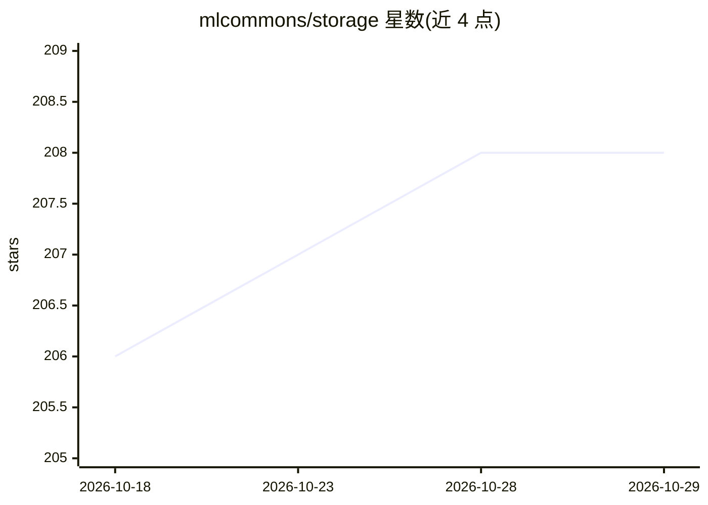

# mlcommons/storage

⭐ 208 · Python · Apache-2.0 · 推送 2026-09-23 · [GitHub](https://github.com/mlcommons/storage) · [官网](https://mlcommons.org/en/groups/research-storage/) · 组织维护

**MLPerf 存储基准套件：评测支撑 ML 工作负载的存储系统性能**

MLCommons 维护的存储基准套件，用 mlpstorage CLI 与基于 DLIO 的 I/O 模拟，评测支持机器学习工作负载（训练、checkpointing、向量数据库、KVCache）的存储系统吞吐。支持文件与 S3 兼容对象存储模式，提供 closed/open/whatif 三种提交模式，附带提交包校验器与规则覆盖自审计命令。安装需 uv 与 OpenMPI，通过 mpirun 在多客户端主机分布式运行；CPU 版 PyTorch 即可，不使用 GPU。在 Ubuntu 24.04、Python 3.12.3 上验证。

## 筛选速览

| 维度 | 判定 | 备注 |
|---|---|---|
| AI 角色 | `ai-ecosystem` | LLM/agent 周边工具 |
| 许可风险 | `permissive` | Apache-2.0 |
| 部署形态 | `library` | 以包/库形式分发 |
| 模型依赖 | — | README 未给出锁定关系 |
| 硬件要求 | `cpu-ok` | |
| 安装摩擦 | `low` | 无编译、无系统依赖或容器化 |
| 成熟度 | — | 结构信号不足 |

## 能力要点

- 四类基准工作负载：training / checkpointing / vectordb / kvcache
- mlpstorage validate 按 Rules.md 校验提交包，rules-coverage 审计校验器自身
- 基于 DLIO 模拟深度学习 I/O 模式，支持文件与 S3 兼容对象存储
- 通过 uv 管理依赖与虚拟环境，mpirun 跨多客户端主机分布式运行

## 适用场景

- 存储厂商生成 MLPerf Storage 提交结果
- 对比不同架构存储系统在 AI 训练 I/O 下的性能（GB/s/RU、GB/s/KW 归一化）
- 以 whatif 模式做容量规划与回归测试

## 场景标签

 · 领域:存储系统/性能基准

## 证据(README 行号)

> L4: # MLPerf Storage Benchmark Suite
> L5: MLPerf® Storage is a benchmark suite to characterize the performance of storage systems that support machine learnin

## 星数曲线

2026-10-18 206 → 2026-10-29 208（+2）

---
*卡片 v1 · prompt 1.4 · 生成 2026-10-22 · 置信度 mid · 依据 README sha `d623a36f7898` · [字段定义](../../DATASET.md)*
