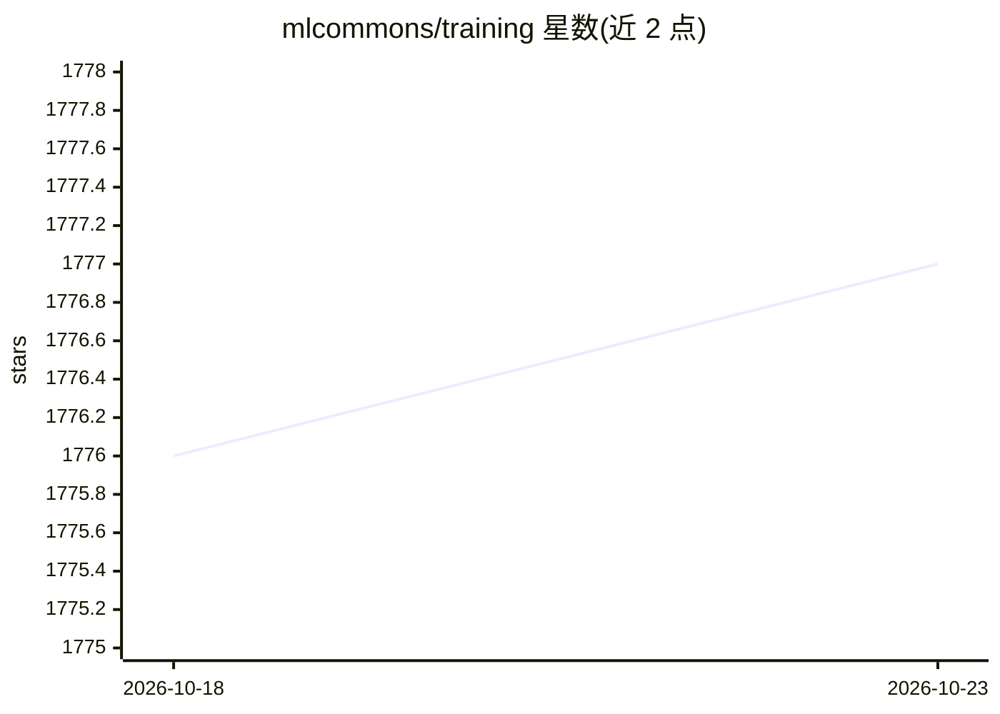

# mlcommons/training

⭐ 1,777 · Python · Apache-2.0 · 推送 2026-09-28 · [GitHub](https://github.com/mlcommons/training) · [官网](https://mlcommons.org/en/groups/training) · 组织维护

**MLPerf Training 基准测试的参考实现集合**

MLCommons 维护的 MLPerf Training 基准参考实现仓库，覆盖 v4.0 至 v6.1 各版本训练基准项：LLM 预训练（Llama、GPT-3、DeepSeek-v3）、文生图（Stable Diffusion、Flux.1）、目标检测（RetinaNet）、推荐系统（DLRMv2）、GNN 等模型与配套数据集。各实现提供 Docker 运行方式，需先在宿主机下载 mlcommons-storage 数据集，基准运行至目标质量后输出计时结果。README 声明参考实现未充分优化，不适用于真实性能测量，且处于 alpha/beta 质量。

## 筛选速览

| 维度 | 判定 | 备注 |
|---|---|---|
| AI 角色 | `ai-ecosystem` | LLM/agent 周边工具 |
| 许可风险 | `permissive` | Apache-2.0 |
| 部署形态 | `None` |  |
| 模型依赖 | — | README 未给出锁定关系 |
| 硬件要求 | — | 无带数字的原话,不猜 |
| 安装摩擦 | `low` | 无编译、无系统依赖或容器化 |
| 成熟度 | `idea` | |

## 能力要点

- 覆盖 v4.0–v6.1 多轮 MLPerf Training 基准的参考实现
- 包含 LLM 预训练/微调、文生图、检测、推荐、GNN 等训练任务
- Docker 运行流程与共享 CUDA 安装脚本 install_cuda_docker.sh
- 基准运行至目标质量后自动停止并输出计时结果

## 适用场景

- 为 MLPerf Training 提交准备基准实现的起点
- 复现各模型训练基准的运行流程与数据集配置
- 查阅各版本基准的模型、框架与数据集对应关系

## 场景标签

`模型评测` · 领域:评测与运维

## 证据(README 行号)

> L1: # MLPerf® Training Reference Implementations
> L3: This is a repository of reference implementations for the MLPerf® training benchmarks. These implementations are val
> L20: Follow instructions on the Readme of each benchmark. Generally, a benchmark can be run with the following steps:

## 星数曲线

2026-10-18 1,776 → 2026-10-23 1,777（+1）

---
*卡片 v1 · prompt 1.4 · 生成 2026-10-21 · 置信度 high · 依据 README sha `cf28c8f6982f` · [字段定义](../../DATASET.md)*
