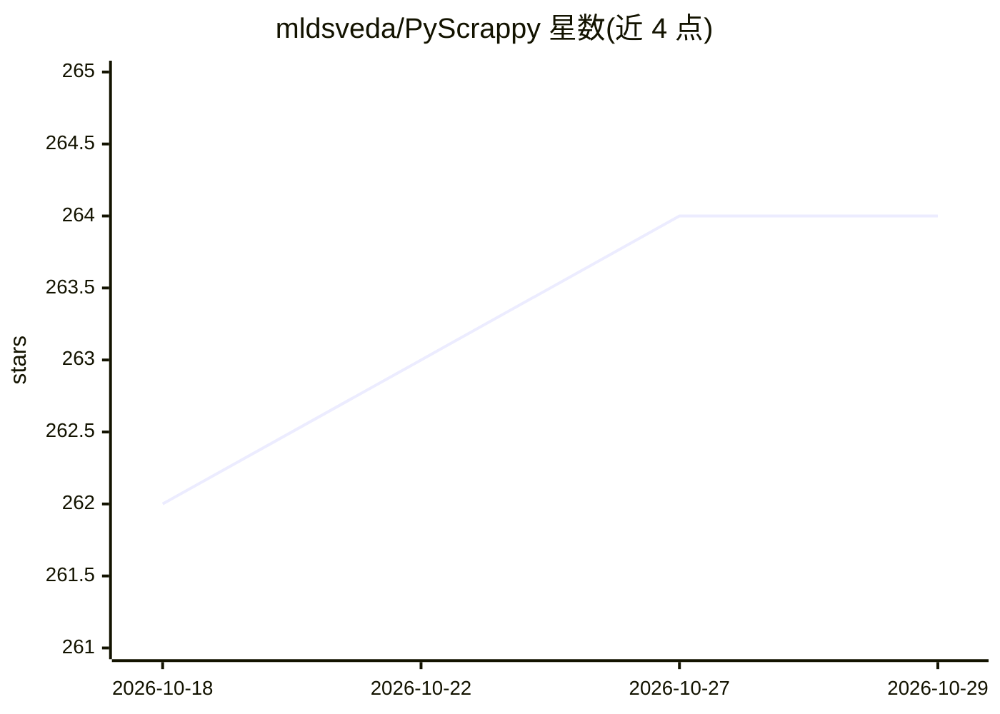

# mldsveda/PyScrappy

⭐ 264 · Python · MIT · 推送 2026-10-22 · [GitHub](https://github.com/mldsveda/PyScrappy) · [官网](https://pyscrappy.vercel.app) · 个人维护

**自愈式 Python 爬虫工具包兼 MCP 服务器：给 AI agent 供给结构化网页数据**

Python 网页抓取工具包（需 Python 3.9+），可将任意 URL 转为结构化文本、链接、图片、表格与元数据，输出 Markdown/JSON/DataFrame 等 LLM 可用格式；内置 24 个站点爬虫（Wikipedia、Yahoo Finance、Amazon、YouTube 等）。核心机制包括自愈选择器（站点改版后按加权信号与锚点相似度重定位元素并记录审计日志）、TLS 指纹伪装（curl_cffi 可选后端）、并发抓取与重试限速。可附带 MCP 服务器把爬虫暴露为工具供 Claude/Cursor 等调用，另含直连 Ollama 的内置 agent；限制：MCP extra 需 Python 3.10+，Instagram/Twitter 等爬虫需代理，IMDB 爬虫需 OMDb key。

## 筛选速览

| 维度 | 判定 | 备注 |
|---|---|---|
| AI 角色 | `ai-ecosystem` | LLM/agent 周边工具 |
| 许可风险 | `permissive` | MIT |
| 部署形态 | `library` | 以包/库形式分发 |
| 模型依赖 | local-ok | 支持本地模型 |
| 硬件要求 | — | 无带数字的原话,不猜 |
| 安装摩擦 | `low` | 无编译、无系统依赖或容器化 |
| 成熟度 | — | 结构信号不足 |

## 能力要点

- 自愈（自适应）选择器：按加权信号与锚点重定位元素，含置信度评分与 append-only 治愈审计日志
- MCP 服务器暴露 20+ 工具供 Claude/Cursor/本地 LLM 调用；内置 agent 可直连 Ollama 免 MCP host
- 24 个内置站点爬虫 + 插件机制（entry point 注册第三方爬虫包）
- TLS 指纹伪装（impersonate=chrome）、并发抓取、站点地图爬取、重试与限速

## 适用场景

- 在 LLM 应用或 agent 中按需抓取网页并得到干净 Markdown/JSON 数据
- 站点改版后让选择器自愈，减少爬虫静默失效
- 注册为 Claude/Cursor/Ollama agent 的抓取工具集
- 批量并发抓取整站（sitemap 爬取）

## 场景标签

`网页抓取` · 领域:效率与自动化

## 证据(README 行号)

> L13: PyScrappy is an AI-native web scraping toolkit that turns websites into structured, LLM-ready data. Use it as a Pyt
> L21: - **MCP server** — expose the scrapers as tools for AI agents (Claude, Cursor, local LLMs, …)
> L52: PyScrappy ships an MCP server that

## 星数曲线

2026-10-18 262 → 2026-10-29 264（+2）

---
*卡片 v1 · prompt 1.4 · 生成 2026-10-22 · 置信度 high · 依据 README sha `550b92dc7a0f` · [字段定义](../../DATASET.md)*
