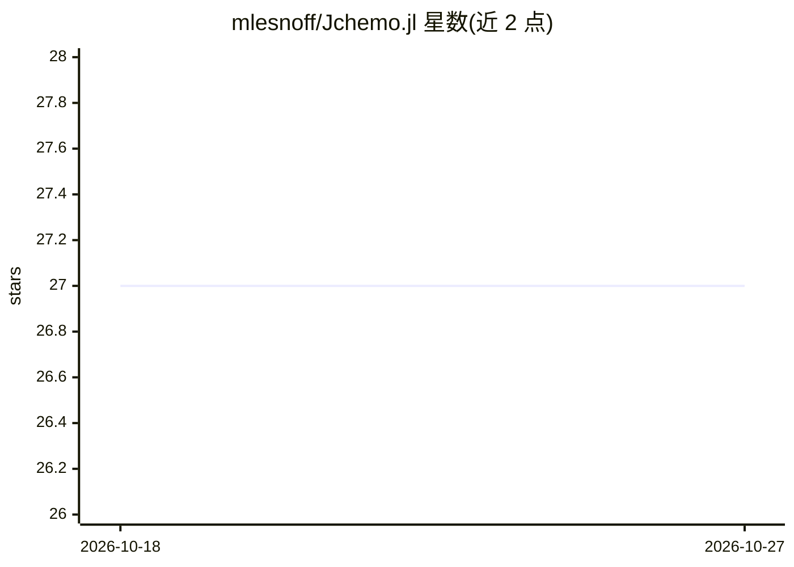

# mlesnoff/Jchemo.jl

⭐ 27 · Julia · MIT · 推送 2026-10-24 · [GitHub](https://github.com/mlesnoff/Jchemo.jl) · 个人维护

**化学计量学与机器学习 Julia 工具箱，面向光谱等高维数据**

Julia 实现的化学计量学工具箱，围绕偏最小二乘回归/判别（PLSR/PLSDA）及其非线性扩展（如 kNN 局部加权 PLS）构建，后扩展至降维、回归、判别与光谱信号预处理等方法。包结构分为 transform 算子、predictor 与工具函数，可通过 pip 函数构建多步流水线；提供 gridscore/gridcv 调参、Makie 绘图（需自行安装后端）与多线程加速。面向化学计量学及相关数据分析的开发者与科研用户，从 Julia Pkg 安装，附 Benchmark 与示例语法。

## 筛选速览

| 维度 | 判定 | 备注 |
|---|---|---|
| AI 角色 | `ai-native` | 本体是模型或模型工具 |
| 许可风险 | `permissive` | MIT |
| 部署形态 | `None` |  |
| 模型依赖 | — | README 未给出锁定关系 |
| 硬件要求 | — | 无带数字的原话,不猜 |
| 安装摩擦 | `low` | 无编译、无系统依赖或容器化 |
| 成熟度 | — | 结构信号不足 |

## 能力要点

- PLSR/PLSDA 及 kNN-LWPLS 等非线性局部加权扩展
- transform/predictor 结构与 pip 函数构建多步建模流水线
- gridscore/gridcv 通用网格调参（潜变量与 ridge 模型有专门加速）
- 光谱预处理（SNV、Savitsky-Golay、去趋势）与 PCA、KPLSR、SVMR 等模型

## 适用场景

- 建立光谱与化学变量间的 PLS 回归/判别模型
- 对高维信号数据做预处理流水线与降维分析
- 用交叉验证网格搜索调优预测模型

## 场景标签

`数据分析` `科研工具` · 领域:效率与自动化

## 证据(README 行号)

> L11: At the start of the project, **Jchemo** was built around **partial least squares regression (PLSR) and discriminati
> L14: Why the name **Jchemo**? Since it is oriented towards **chemometrics**, in brief the use of biometry to relate chem

## 星数曲线

2026-10-18 27 → 2026-10-27 27（+0）

---
*卡片 v1 · prompt 1.4 · 生成 2026-10-26 · 置信度 high · 依据 README sha `303bea99d1e6` · [字段定义](../../DATASET.md)*
