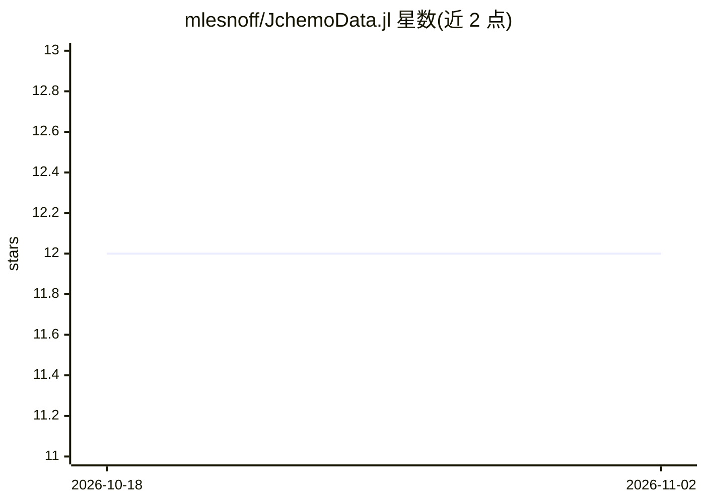

# mlesnoff/JchemoData.jl

⭐ 12 · Julia · 推送 2026-10-16 · [GitHub](https://github.com/mlesnoff/JchemoData.jl) · 个人维护

**化学计量学数据集仓库：JLD2/CSV 格式的 NIR 光谱等数据**

Julia 数据包，收录化学计量学及相关领域数据集（JLD2、CSV 等格式），部分数据用于 Jchemo 与 JchemoDemo 的示例。内容以近红外（NIR）光谱数据为主，涵盖木薯、谷物、玉米、葡萄、芒果、辛烷值、MNIST 20% 抽取等约 17 个数据集，多数附响应变量、来源与文献引用。数据经 Julia REPL 通过 JLD2 包加载，以 pkg> add GitHub 仓库方式安装。私有来源数据（如 forages2、grapevariety）经匿名化或预处理后发布。

## 筛选速览

| 维度 | 判定 | 备注 |
|---|---|---|
| AI 角色 | `ai-knowledge` | 知识聚合/清单类 |
| 许可风险 | `none` | — |
| 部署形态 | `None` |  |
| 模型依赖 | — | README 未给出锁定关系 |
| 硬件要求 | — | 无带数字的原话,不猜 |
| 安装摩擦 | `low` | 无编译、无系统依赖或容器化 |
| 成熟度 | — | 结构信号不足 |

## 能力要点

- 约 17 个 JLD2 数据集，以 NIR 光谱数据为主
- 多数数据集附响应变量、来源与文献引用
- 部分私有数据经匿名化/预处理后发布
- 数据集持续新增（见 commits）

## 适用场景

- 为 Jchemo/JchemoDemo 示例提供配套数据
- 化学计量学建模（PLS 回归/判别）的基准数据
- 近红外光谱方法研究的测试数据来源

## 场景标签

 · 领域:化学计量学/数据集

## 证据(README 行号)

> L5: The Julia package **JchemoData** is a repository containing datasets (chemometrics and others) in various formats (J
> L6: datasets are used in the examples provided in **Jchemo** and **JchemoDemo**.

## 星数曲线

2026-10-18 12 → 2026-11-02 12（+0）

---
*卡片 v1 · prompt 1.4 · 生成 2026-11-01 · 置信度 high · 依据 README sha `5475ce07c7a7` · [字段定义](../../DATASET.md)*
