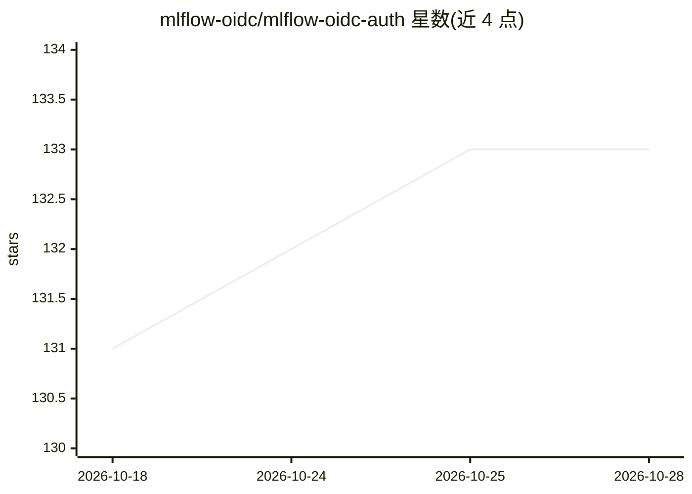

# mlflow-oidc/mlflow-oidc-auth

⭐ 133 · Python · Apache-2.0 · 推送 2026-10-21 · [GitHub](https://github.com/mlflow-oidc/mlflow-oidc-auth) · [官网](https://mlflow-oidc.github.io/mlflow-oidc-auth/) · 组织维护

**MLflow 追踪服务器的认证与访问控制插件（SSO/SCIM/RBAC）**

以 MLflow server 插件形式提供的认证与授权层：通过 OIDC（含 PKCE 公共客户端）或 SAML 2.0 实现 UI/API 单点登录，支持多个 IdP 并存；自动化访问使用 Kubernetes service-account token、IdP client-credentials/workload-identity token（JWT bearer），人员则用命名个人访问令牌。提供 SCIM 2.0 用户/组同步、按实验/注册模型/prompt 等资源的四级权限（默认拒绝）、多租户工作区、管理 UI、审计日志与 Redis 权限缓存。pip 安装后以 --app-name oidc-auth 启动，面向部署 MLflow 的团队与企业。非 MLflow 官方项目。

## 筛选速览

| 维度 | 判定 | 备注 |
|---|---|---|
| AI 角色 | `ai-ecosystem` | LLM/agent 周边工具 |
| 许可风险 | `permissive` | Apache-2.0 |
| 部署形态 | `library` | 以包/库形式分发 |
| 模型依赖 | — | README 未给出锁定关系 |
| 硬件要求 | — | 无带数字的原话,不猜 |
| 安装摩擦 | `low` | 无编译、无系统依赖或容器化 |
| 成熟度 | — | 结构信号不足 |

## 能力要点

- OIDC/SAML 2.0 单点登录，支持多 IdP 并存与 PKCE 公共客户端
- READ/USE/EDIT/MANAGE 四级权限，默认拒绝，覆盖实验、模型、prompt 等资源
- SCIM 2.0 用户与组自动供给，K8s/IdP workload identity 程序化访问
- 多租户工作区、管理 UI、审计日志、Redis 权限缓存

## 适用场景

- 给共享的 MLflow 追踪服务器加企业 SSO 登录
- 按用户/组/正则控制实验与模型的访问权限
- 多租户团队在同一 MLflow 服务器上隔离资源
- CI/CD 与 Kubernetes 工作负载以短时效身份访问 MLflow API

## 场景标签

`MLOps` · 领域:训练与推理

## 证据(README 行号)

> L6: Authentication and access control for MLflow tracking servers: single sign-on (OIDC, SAML 2.0), SCIM user and group 
> L8: It is an MLflow server plugin, installed as `mlflow-oidc-auth` and started with `--app-name oidc-auth`. The package 

## 星数曲线

2026-10-18 131 → 2026-10-28 133（+2）

---
*卡片 v1 · prompt 1.4 · 生成 2026-10-22 · 置信度 high · 依据 README sha `78b67ef12609` · [字段定义](../../DATASET.md)*
