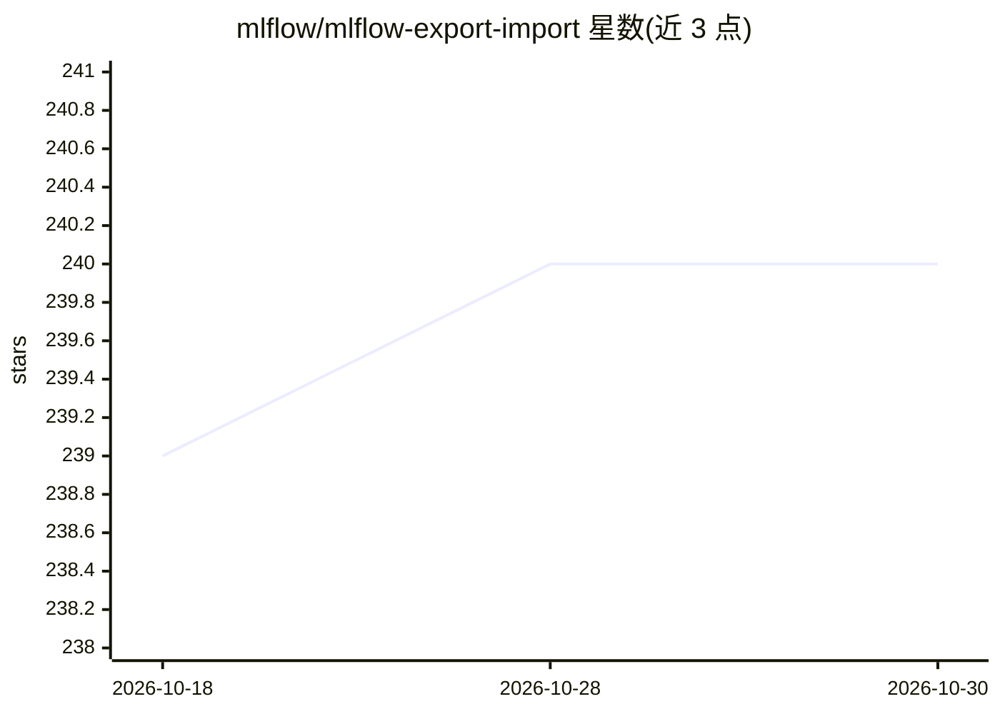

# mlflow/mlflow-export-import

⭐ 240 · Python · Apache-2.0 · 推送 2026-10-02 · [GitHub](https://github.com/mlflow/mlflow-export-import) · 组织维护

**MLflow 对象跨服务器迁移工具：导出导入 runs/实验/模型**

基于 MLflow REST API 的迁移工具包，将 runs、experiments、registered models 等 MLflow 对象从一个 tracking server（Databricks workspace、Amazon SageMaker MLflow）导出到中间目录再导入目标服务器。支持单个与批量两种模式，批量模式保持对象引用完整性；提供保存原对象属性的谱系追踪选项。适用于 MLOps 流水线中的开发→测试→生产晋升、跨用户共享与备份容灾。要求 Python 3.8+，通过 pip 从 GitHub 安装，也可在 Databricks notebook 中以 %pip 或 wheel 方式安装；PyPI 安装方式已被标记为弃用。多线程导出为实验特性。

## 筛选速览

| 维度 | 判定 | 备注 |
|---|---|---|
| AI 角色 | `ai-ecosystem` | LLM/agent 周边工具 |
| 许可风险 | `permissive` | Apache-2.0 |
| 部署形态 | `library` | 以包/库形式分发 |
| 模型依赖 | — | README 未给出锁定关系 |
| 硬件要求 | — | 无带数字的原话,不猜 |
| 安装摩擦 | `low` | 无编译、无系统依赖或容器化 |
| 成熟度 | — | 结构信号不足 |

## 能力要点

- 支持 runs、experiments、registered models、traces、prompts 等多类 MLflow 对象的导出导入
- 单个与批量两种模式，批量模式维护完整对象引用完整性
- 兼容 Databricks Workspace/Unity Catalog 与 Amazon SageMaker MLflow 迁移场景
- 可保存原始对象属性以追踪导入对象的谱系

## 适用场景

- 把最佳 run 从开发 tracking server 晋升到测试/生产环境
- 跨用户或跨工作区共享实验与模型
- 将 MLflow 对象备份到外部存储以备容灾恢复
- 迁移到 SageMaker MLflow 环境

## 场景标签

`MLOps` · 领域:训练与推理

## 证据(README 行号)

> L3: The MLflow Export Import package provides tools to copy MLflow objects (runs, experiments or registered models) from
> L17:  * Enable an MLOps pipeline by promoting MLflow objects (runs, experiments or registered models) from one MLflow tr

## 星数曲线

2026-10-18 239 → 2026-10-30 240（+1）

---
*卡片 v1 · prompt 1.4 · 生成 2026-10-22 · 置信度 high · 依据 README sha `27ea65eeef7d` · [字段定义](../../DATASET.md)*
