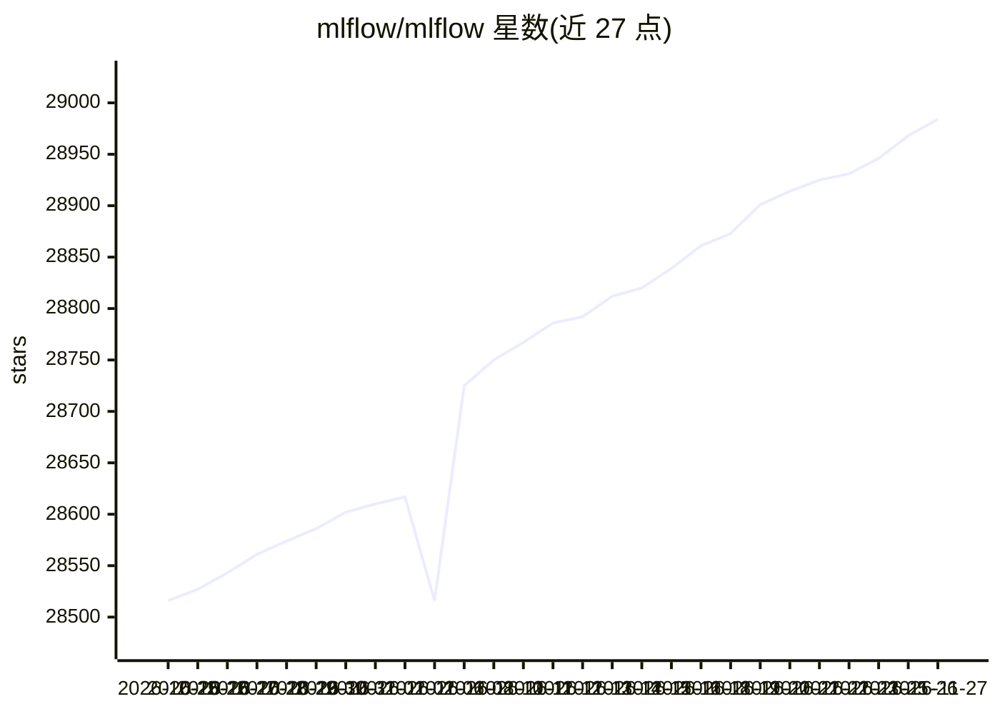

# mlflow/mlflow

⭐ 28,984 · Python · Apache-2.0 · 推送 2026-11-26 · [GitHub](https://github.com/mlflow/mlflow) · [官网](https://mlflow.org) · 组织维护

**面向 agents、LLM 与 ML 模型的开源 AI 工程平台**

MLflow 为团队提供 agents 与 LLM 应用的构建、调试、评估与部署工具集：基于 OpenTelemetry 的可观测性追踪、50+ 内置指标与 LLM judges 的系统评估、带版本与血缘追踪的 prompt 管理与自动优化，以及统一管理模型访问、限流、回退与成本的 AI Gateway。同时覆盖 ML 生命周期的实验追踪、模型评估、模型注册与部署（Docker/Kubernetes 等）。支持 Python、TypeScript/JavaScript、Java 等语言，可本地、自托管或托管服务运行，声明为 vendor-neutral。

## 筛选速览

| 维度 | 判定 | 备注 |
|---|---|---|
| AI 角色 | `ai-ecosystem` | LLM/agent 周边工具 |
| 许可风险 | `permissive` | Apache-2.0 |
| 部署形态 | `library` | 以包/库形式分发 |
| 模型依赖 | — | README 未给出锁定关系 |
| 硬件要求 | — | 无带数字的原话,不猜 |
| 安装摩擦 | `low` | 无编译、无系统依赖或容器化 |
| 成熟度 | — | 结构信号不足 |

## 动量与使用信号

- 维护:`active` — 距上次 push 1.0 天,年发版 33,447 位贡献者
- 涨星:近 1 天 **+17**(自 20261016 起算)
- 平台:— · 协议:OPENAI-API / MCP / OLLAMA

## 能力要点

- 基于 OpenTelemetry 的 LLM/agent 追踪，支持任意提供商与框架
- 50+ 内置指标与 LLM judges 的系统化评估
- OpenAI 兼容接口的 AI Gateway（限流、回退、凭据管理、A/B 流量切分）
- 对 60+ 框架提供一行代码自动追踪

## 适用场景

- 为生产中的 LLM 应用与 agent 追踪调用链并监控质量与成本
- 上线前对 LLM 应用做系统性评估并捕捉回归
- 集中管理 prompt 版本与血缘
- 统一 API 网关管理多模型访问与成本

## 场景标签

`提示工程` `LLM 可观测性` `模型评测` `MLOps` · 领域:Agent 开发

## 证据(README 行号)

> L7: MLflow is the largest open source **AI engineering platform for agents, LLMs, and ML models**. MLflow enables teams 
> L12: MLflow's comprehensive feature set for agents and LLM applications includes production-grade observability, evaluat
> L106:  Unified API gateway for all LLM providers. Route requests, manage rate limits, handle fallbacks, and control cost

## 星数曲线

2026-10-25 28,516 → 2026-11-27 28,984（+468）

---
*卡片 v1 · prompt 1.4 · 生成 2026-11-23 · 置信度 mid · 依据 README sha `03f1ffb89937` · [字段定义](../../DATASET.md)*
