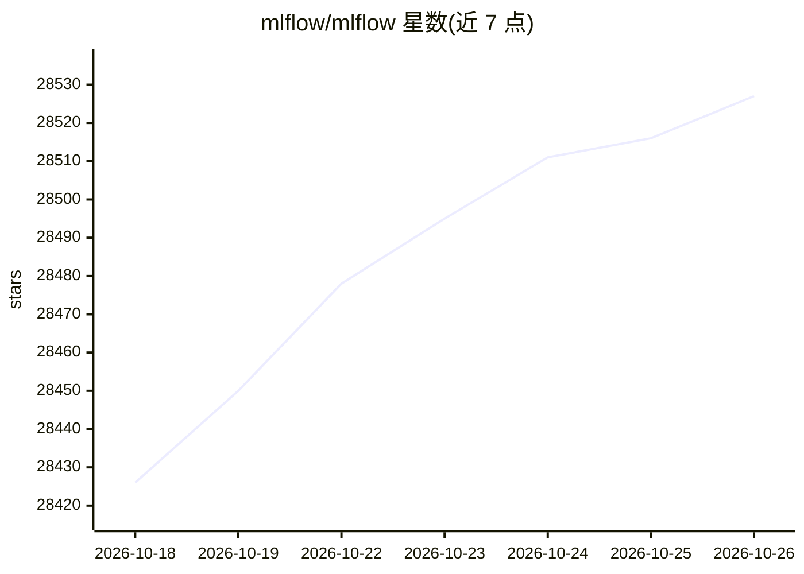

# mlflow/mlflow

⭐ 28,527 · Python · Apache-2.0 · 推送 2026-10-25 · [GitHub](https://github.com/mlflow/mlflow) · [官网](https://mlflow.org) · 组织维护

**AI 工程 平台：调试/评估/监控 agent 与 LLM 应用**

面向 agents、LLM 与 ML 模型的开源 AI 工程平台，功能包括基于 OpenTelemetry 的可观测性追踪、带 50+ 内置指标与 LLM judge 的系统化评估、带版本与血缘的 prompt 管理与自动优化、以及提供 OpenAI 兼容接口的 AI Gateway；另覆盖实验追踪、模型注册与部署等传统 ML 生命周期管理。支持 Python、TypeScript/JavaScript、Java 等语言，对 60+ 框架提供一行式自动追踪，可本地、本地集群或云平台部署。

## 筛选速览

| 维度 | 判定 | 备注 |
|---|---|---|
| AI 角色 | `ai-ecosystem` | LLM/agent 周边工具 |
| 许可风险 | `permissive` | Apache-2.0 |
| 部署形态 | `library` | 以包/库形式分发 |
| 模型依赖 | — | README 未给出锁定关系 |
| 硬件要求 | — | 无带数字的原话,不猜 |
| 安装摩擦 | `low` | 无编译、无系统依赖或容器化 |
| 成熟度 | — | 结构信号不足 |

## 动量与使用信号

- 维护:`active` — 距上次 push 1.0 天,年发版 33,447 位贡献者
- 涨星:近 1 天 **+17**(自 20261016 起算)
- 平台:— · 协议:OPENAI-API / MCP / OLLAMA

## 能力要点

- 基于 OpenTelemetry 的 LLM/agent 追踪可观测性，支持 60+ 框架一行接入
- 50+ 内置评估指标与 LLM judge，跟踪质量指标与回归
- AI Gateway：OpenAI 兼容统一网关，含限流、回退、凭证管理与 A/B 流量切分
- 实验追踪、模型评估、模型注册与部署（Docker/Kubernetes/Azure ML/AWS SageMaker）

## 适用场景

- 为 LLM 应用与 agent 建立生产环境的调用链追踪与监控
- 系统化评估模型质量并跟踪回归
- 版本化与自动优化 prompt
- 管理 ML 实验与模型部署生命周期

## 场景标签

`LLM 可观测性` `模型评测` `MLOps` `提示工程` · 领域:Agent 开发

## 证据(README 行号)

> L7: MLflow is the largest open source **AI engineering platform for agents, LLMs, and ML models**. MLflow enables teams 
> L73: MLflow provides everything you need to build, debug, evaluate, and deploy production-quality LLM applications and A
> L122: MLflow supports all agent frameworks, LLM providers, tools, and programming languages. We offer one-line automatic

## 星数曲线

2026-10-18 28,426 → 2026-10-26 28,527（+101）

---
*卡片 v1 · prompt 1.4 · 生成 2026-10-18 · 置信度 high · 依据 README sha `23c13649e58c` · [字段定义](../../DATASET.md)*
