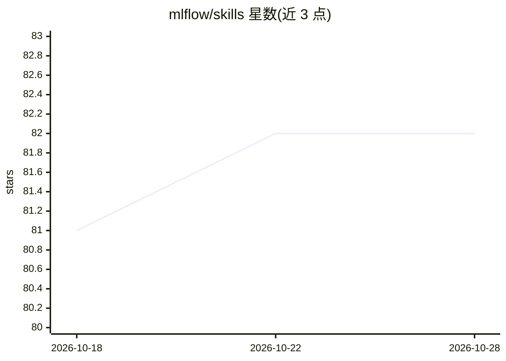

# mlflow/skills

⭐ 82 · Python · Apache-2.0 · 推送 2026-10-26 · [GitHub](https://github.com/mlflow/skills) · 组织维护

**给编程 Agent 的 MLflow 技能包：指导其完成追踪、评估与调试**

MLflow 官方维护的 coding agent 技能集合，以 SKILL 形式向 Claude Code、Cursor、Codex CLI、Gemini CLI、OpenCode 等支持 Skills 的编程助手注入 MLflow 追踪、评测与可观测性操作知识，覆盖 Python/TypeScript 代码埋点、trace 与会话诊断、agent 评测工作流、scorer 设计、指标查询与文档检索等 11 项技能。提供 npx 安装器、源码复制与项目级安装三种途径，另有可选的 UserPromptSubmit 自动提示钩子。要求 MLflow 3.8+。

## 筛选速览

| 维度 | 判定 | 备注 |
|---|---|---|
| AI 角色 | `ai-ecosystem` | LLM/agent 周边工具 |
| 许可风险 | `permissive` | Apache-2.0 |
| 部署形态 | `library` | 以包/库形式分发 |
| 模型依赖 | — | README 未给出锁定关系 |
| 硬件要求 | — | 无带数字的原话,不猜 |
| 安装摩擦 | `low` | 无编译、无系统依赖或容器化 |
| 成熟度 | — | 结构信号不足 |

## 能力要点

- 11 个技能覆盖追踪埋点、trace/会话诊断、agent 评测与 scorer 构建
- 兼容任何支持 Skills 的编程 Agent（Claude Code/Cursor/Codex CLI/Gemini CLI/OpenCode）
- npx skills add 一键安装，另有源码复制与项目级/子模块安装方式
- 可选 UserPromptSubmit 钩子按提示词自动推荐对应技能

## 适用场景

- 让编程 Agent 自动为 LangChain/OpenAI 应用添加 MLflow 追踪
- 通过对话定位失败 trace 的根因并获取修复建议
- 搭建 agent 评测的数据集、scorer 与执行流程
- 查询 token 用量、延迟与错误率等指标趋势

## 场景标签

`提示工程` `LLM 可观测性` `模型评测` · 领域:Agent 开发

## 证据(README 行号)

> L7: Build, debug, and evaluate GenAI applications with confidence. These skills give your AI coding assistant deep knowl
> L9: Works with any coding agent that support Skills, including Claude Code, Cursor, Codex CLI, Gemini CLI, and OpenCode.

## 星数曲线

2026-10-18 81 → 2026-10-28 82（+1）

---
*卡片 v1 · prompt 1.4 · 生成 2026-10-24 · 置信度 high · 依据 README sha `781feeb72ecf` · [字段定义](../../DATASET.md)*
