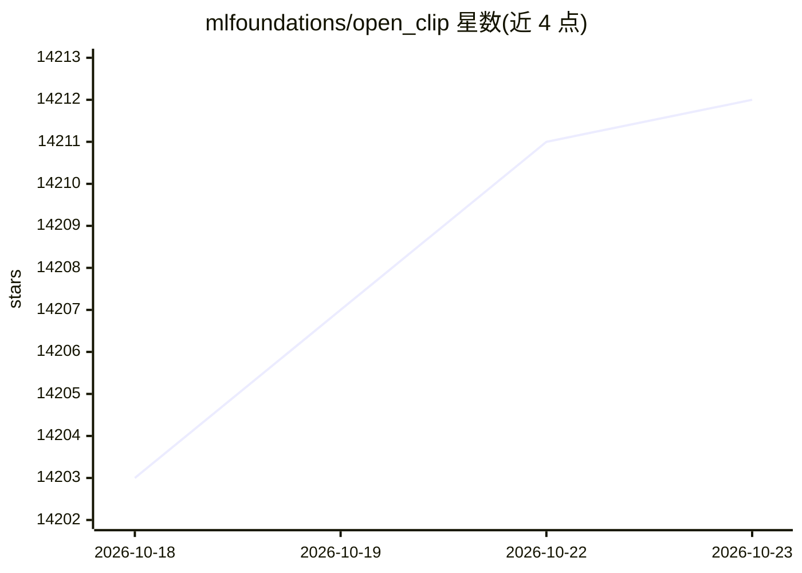

# mlfoundations/open_clip

⭐ 14,212 · Python · NOASSERTION · 推送 2026-09-30 · [GitHub](https://github.com/mlfoundations/open_clip) · 组织维护

**给研究者的开源 CLIP（图文对比学习）PyTorch 实现**

CLIP 的开源实现，基于 PyTorch 提供图文对比学习模型的训练与推理。main 分支的训练栈围绕 TrainingTask 封装、dict 批次、FSDP2、NaFlex 图像/音频管线与多种 torch.compile 策略组织，新增 CLAP 音频-文本、CoCa、MaMMUT、SigLIP 等模型族配置；旧版训练 API 需固定到 v3 分支或 PyPI 3.x 版本。预训练图文模型的推理用法保持兼容。提供论文链接与 Colab 示例。

## 筛选速览

| 维度 | 判定 | 备注 |
|---|---|---|
| AI 角色 | `ai-ecosystem` | LLM/agent 周边工具 |
| 许可风险 | `none` | NOASSERTION |
| 部署形态 | `library` | 以包/库形式分发 |
| 模型依赖 | — | README 未给出锁定关系 |
| 硬件要求 | — | 无带数字的原话,不猜 |
| 安装摩擦 | `medium` | 含编译或系统依赖之一 |
| 成熟度 | — | 结构信号不足 |

## 动量与使用信号

- 维护:`active` — 距上次 push 17.7 天,年发版 1,65 位贡献者
- 涨星:近 1 天 **+4**(自 20261016 起算)
- 安装:pypi 包 `open_clip_torch` 月下载无数据

## 能力要点

- CLIP 的开源 PyTorch 实现，支持训练与预训练模型推理
- 训练支持 FSDP2、多种 torch.compile 策略与 NaFlex 可变分辨率/音频管线
- 包含 CLIP、SigLIP、CoCa、MaMMUT、CLAP 等模型族配置
- 提供交互式 Colab notebook 与论文引用入口

## 适用场景

- 训练自定义图文对比学习模型
- 加载预训练 CLIP/CoCa 模型做图像-文本特征提取
- 音频-文本对比学习（CLAP）实验

## 场景标签

`模型训练` `多模态` · 领域:感知与多模态

## 证据(README 行号)

> L1: # OpenCLIP
> L8: > `main` now uses the post-refactor training stack by default. Training is organized around `TrainingTask` wrappers,
> L45: > - Training pipeline wraps `model + loss` in a `TrainingTask` subclass (`CLIPTask`, `SigLIPTask`, `CoCaTask`, `Dis

## 星数曲线

2026-10-18 14,203 → 2026-10-23 14,212（+9）

---
*卡片 v1 · prompt 1.4 · 生成 2026-10-18 · 置信度 high · 依据 README sha `3c112733cbca` · [字段定义](../../DATASET.md)*
