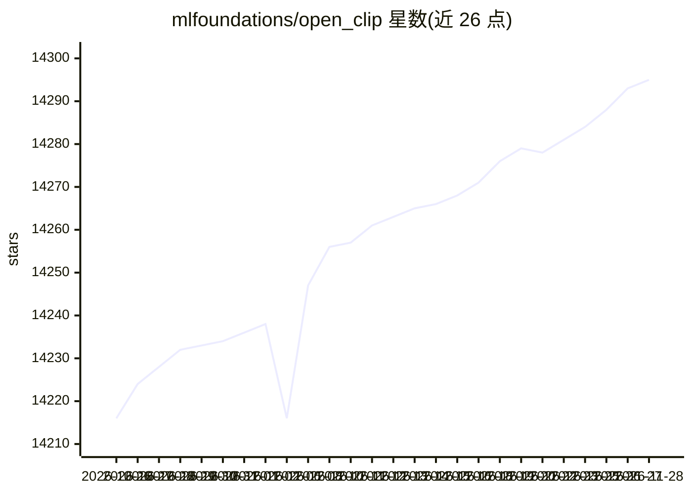

# mlfoundations/open_clip

⭐ 14,295 · Python · NOASSERTION · 推送 2026-11-27 · [GitHub](https://github.com/mlfoundations/open_clip) · 组织维护

**CLIP 的开源 PyTorch 实现：训练与加载图文/音频多模态模型**

OpenAI CLIP（对比语言-图像预训练）的开源实现，另包含语言-音频（CLAP）模型与相关生成式模型。基于该代码库在 LAION-400M/2B、DataComp-1B 等数据集上训练了多系列模型，提供预训练与未训练模型的统一实例化接口、零样本评估与线性探针辅助脚本，支持 webdataset 格式训练数据与 FSDP2 等训练栈功能。要求 Python 3.9+ 与 PyTorch 2.6+，通过 pip 安装，训练需额外安装 training 依赖组。

## 筛选速览

| 维度 | 判定 | 备注 |
|---|---|---|
| AI 角色 | `ai-native` | 本体是模型或模型工具 |
| 许可风险 | `none` | NOASSERTION |
| 部署形态 | `library` | 以包/库形式分发 |
| 模型依赖 | — | README 未给出锁定关系 |
| 硬件要求 | — | 无带数字的原话,不猜 |
| 安装摩擦 | `medium` | 含编译或系统依赖之一 |
| 成熟度 | — | 结构信号不足 |

## 动量与使用信号

- 维护:`active` — 距上次 push 17.7 天,年发版 1,65 位贡献者
- 涨星:近 1 天 **+4**(自 20261016 起算)
- 安装:pypi 包 `open_clip_torch` 月下载无数据

## 能力要点

- 提供 open_clip.create_model_and_transforms 统一加载预训练/未训练模型，支持本地路径与 Hugging Face 权重
- 包含 CLAP 2（NaFlex CLAP）可变长度音频-文本模型系列
- 训练栈支持 FSDP2、torch.compile 策略、长度分桶
- 提供多标签零样本评估与线性探针辅助脚本

## 适用场景

- 训练自定义图文对比学习模型（支持 webdataset 大规模数据）
- 加载预训练模型做零样本图像分类
- 将音频与文本映射到共享嵌入空间（CLAP）
- 批量计算大规模图像/文本嵌入

## 场景标签

`多模态` `模型训练` `模型评测` · 领域:评测与运维

## 证据(README 行号)

> L12: Welcome to an open source implementation of OpenAI's CLIP (Contrastive Language-Image Pre-training). OpenCLIP also 
> L71: OpenCLIP requires Python 3.9+ and PyTorch 2.6+. Python 3.14 and 3.15 have been validated with PyTorch 2.15 for infe
> L74: pip install open_clip_torch

## 星数曲线

2026-10-26 14,216 → 2026-11-28 14,295（+79）

---
*卡片 v1 · prompt 1.4 · 生成 2026-11-22 · 置信度 high · 依据 README sha `14148ea692f3` · [字段定义](../../DATASET.md)*
