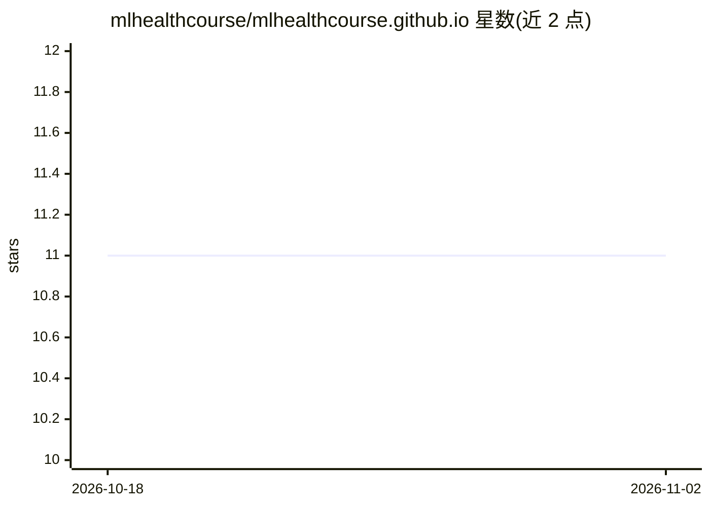

# mlhealthcourse/mlhealthcourse.github.io

⭐ 11 · Python · NOASSERTION · 推送 2026-08-12 · [GitHub](https://github.com/mlhealthcourse/mlhealthcourse.github.io) · [官网](https://mlhealthcourse.github.io/) · 个人维护

**面向健康研究者的统计与机器学习实用课程（R+Python）**

名为 statML 的 Quarto 在线书籍课程，覆盖概率与推断、高级统计方法（样条、惩罚回归、生存分析、混合效应、缺失数据）、贝叶斯方法、监督/无监督学习、临床预测模型开发与 TRIPOD+AI 报告、因果推断与 meta 分析。面向已掌握基础统计的健康研究者，每章配临床数据示例、练习与起始代码，全部内容提供 R 与 Python 双语言版本。使用 pixi 管理依赖（Quarto、R、Python 包）以本地渲染，内容以 CC BY 4.0 许可发布。

## 筛选速览

| 维度 | 判定 | 备注 |
|---|---|---|
| AI 角色 | `ai-knowledge` | 知识聚合/清单类 |
| 许可风险 | `none` | NOASSERTION |
| 部署形态 | `None` |  |
| 模型依赖 | — | README 未给出锁定关系 |
| 硬件要求 | — | 无带数字的原话,不猜 |
| 安装摩擦 | `low` | 无编译、无系统依赖或容器化 |
| 成熟度 | — | 结构信号不足 |

## 能力要点

- 24 章覆盖统计方法、贝叶斯、监督/无监督学习与因果推断
- 全书 R/Python 双语言代码与临床示例
- 含 TRIPOD+AI 临床预测模型报告规范
- pixi 管理全部依赖并支持本地渲染

## 适用场景

- 系统学习医学期刊中出现的统计与机器学习方法
- 开发并规范报告临床预测模型
- 在 R 或 Python 中对照练习同一分析方法

## 场景标签

`教程课程` · 领域:学习与行业

## 证据(README 行号)

> L3:  Advanced Statistics and Machine Learning for Health Research
> L25: Researchers who know basic statistics (means, t-tests, maybe some regression)

## 星数曲线

2026-10-18 11 → 2026-11-02 11（+0）

---
*卡片 v1 · prompt 1.4 · 生成 2026-11-02 · 置信度 high · 依据 README sha `e1f81a7663cd` · [字段定义](../../DATASET.md)*
