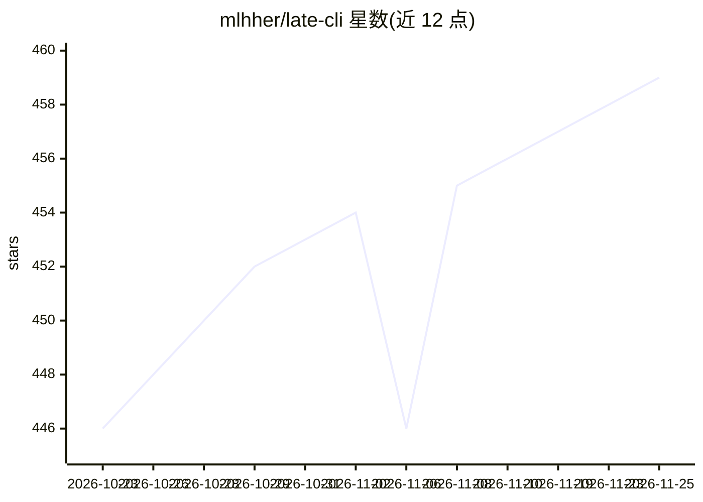

# mlhher/late-cli

⭐ 459 · Go · NOASSERTION · 推送 2026-11-22 · [GitHub](https://github.com/mlhher/late-cli) · 个人维护

**面向本地模型的编码 agent CLI：隔离上下文长任务不掉链**

用 Go 编写的终端编码 agent，单静态二进制、零运行时依赖。核心机制是将主编排器与临时 Coder/Researcher 子代理隔离：子代理的中间执行噪声在任务完成后销毁，仅结构化结果回传，使编排器上下文维持在 64k 以内而累计任务可达数十万 token。还提供针对 llama.cpp/llama-server 的实时 logit 偏置、工具注册表剪枝、并行子代理（默认关闭）、插件系统（npm/Git/本地目录）与基于 podman 的无根 devcontainer 沙箱。定位本地模型工作流，自动发现运行在 :9931 端口的 llama-server。

## 筛选速览

| 维度 | 判定 | 备注 |
|---|---|---|
| AI 角色 | `ai-native` | 本体是模型或模型工具 |
| 许可风险 | `none` | NOASSERTION |
| 部署形态 | `None` |  |
| 模型依赖 | local-ok | 支持本地模型 |
| 硬件要求 | — | 无带数字的原话,不猜 |
| 安装摩擦 | `low` | 无编译、无系统依赖或容器化 |
| 成熟度 | — | 结构信号不足 |

## 能力要点

- 主编排器与子代理架构性强隔离，子代理临时上下文用后销毁
- 对 llama.cpp/llama-server 实现实时 logit 偏置抑制冗余思考 token
- 并行子代理可通过 --max-async-subagents 启用，工具注册表物理剪枝
- Go 静态二进制，启动 <10ms，无遥测

## 适用场景

- 在消费级硬件上用量化本地模型跑长周期编码任务
- 让 agent 自主解决跨文件重构与合并冲突
- 在一次性容器中 overnight 自主运行编码工作流

## 场景标签

`编码 Agent` · 领域:编码与开发

## 证据(README 行号)

> L7:  Late isolates execution steps to keep your model's context clean during long workflows.
> L63: 1. **Architecturally Enforced Isolation:** The Lead Orchestrator strictly plans and verifies. It spawns ephemeral C
> L147: Zero config. Point `llama-server` at any GGUF and Late connects on `:9931` automatically.

## 星数曲线

2026-10-23 446 → 2026-11-25 459（+13）

---
*卡片 v1 · prompt 1.4 · 生成 2026-11-25 · 置信度 high · 依据 README sha `820934568b8c` · [字段定义](../../DATASET.md)*
