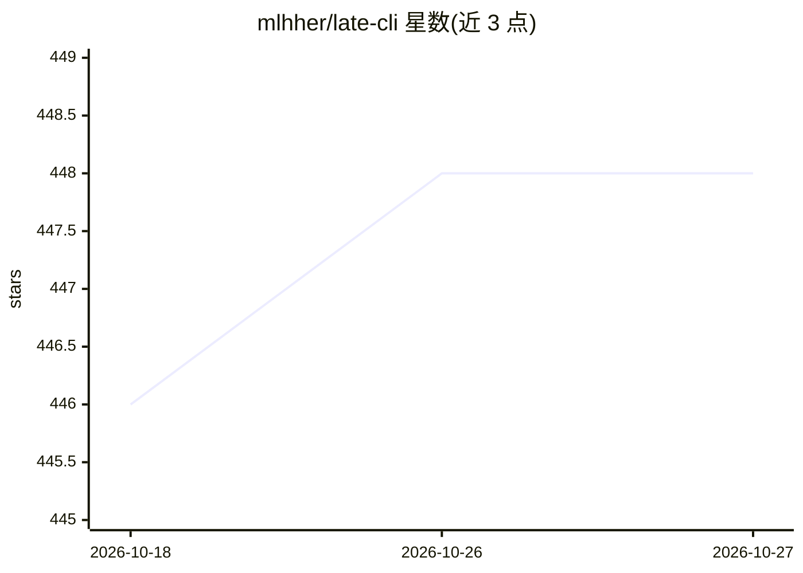

# mlhher/late-cli

⭐ 448 · Go · NOASSERTION · 推送 2026-10-19 · [GitHub](https://github.com/mlhher/late-cli) · 个人维护 · 中文 README

**面向本地模型长程任务的 AI 编码 agent，上下文隔离编排**

以单一 Go 二进制提供的 AI 编码 agent（harness）。核心机制是 Lead Orchestrator 只做规划与验证，代码/研究工作派发给临时子 agent，子 agent 完成后其上下文被清除，仅结构化诊断返回主上下文，使 64k 窗口模型可承担 200k+ token 累计工作。通过 llama-server（:9931）零配置连接本地 GGUF 模型，也可经环境变量接入 DeepSeek、Claude、GPT、Kimi、GLM、OpenRouter 等云端服务。提供插件系统、logit biasing 与 late-podman 沙箱。实测记录基于 35B-A3B 3-bit 量化模型。

## 筛选速览

| 维度 | 判定 | 备注 |
|---|---|---|
| AI 角色 | `ai-ecosystem` | LLM/agent 周边工具 |
| 许可风险 | `none` | NOASSERTION |
| 部署形态 | `None` |  |
| 模型依赖 | local-ok | 支持本地模型 |
| 硬件要求 | — | 无带数字的原话,不猜 |
| 安装摩擦 | `low` | 无编译、无系统依赖或容器化 |
| 成熟度 | — | 结构信号不足 |

## 能力要点

- 编排器/子 agent 架构强制隔离，子 agent 上下文用后即清
- 对 llama.cpp/llama-server 实现实时 logit biasing 抑制冗余思考 token
- 单一静态编译 Go 二进制，零依赖，<10ms 启动
- 本地 llama-server 零配置接入，云端经 OPENAI_BASE_URL 等环境变量

## 适用场景

- 在 5GB VRAM 本地模型上跑多文件重构等长程编码任务
- 让小上下文模型承担超过自身窗口的累计工作量
- 在隔离容器中自主执行规划-编码-测试闭环

## 场景标签

`编码 Agent` `多智能体` · 领域:Agent 开发

## 证据(README 行号)

> L6:  64k context window. 200k+ tokens of work.
> L137: Late is engineered as an end-to-end harness:

## 星数曲线

2026-10-18 446 → 2026-10-27 448（+2）

---
*卡片 v1 · prompt 1.4 · 生成 2026-10-21 · 置信度 high · 依据 README sha `7bb1d1d9e70a` · [字段定义](../../DATASET.md)*
