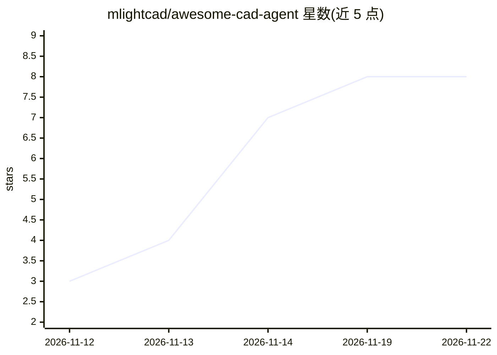

# mlightcad/awesome-cad-agent

⭐ 8 · 推送 2026-11-17 · [GitHub](https://github.com/mlightcad/awesome-cad-agent) · 组织维护

**连接 CAD 与 AI agent 的开源项目策展清单**

一份 awesome-list 形式的策展清单，收录连接 CAD（计算机辅助设计）与 AI agent 的开源项目，分为 AI-native CAD 应用、CAD MCP 服务器、CAD agent 与 agentic 工作流、agent 技能四类。每条目给出仓库链接与功能要点，覆盖 FreeCAD、SolidWorks、Rhino、Onshape、KiCad、OpenSCAD 等具体 CAD 平台的 MCP 集成，以及 text-to-CAD、参数化建模等工作流。清单本身不提供可安装软件，定位是 FreeCAD/AutoCAD 相关 MCP 与 agent 生态的导航资源。

## 筛选速览

| 维度 | 判定 | 备注 |
|---|---|---|
| AI 角色 | `ai-knowledge` | 知识聚合/清单类 |
| 许可风险 | `none` | — |
| 部署形态 | `None` |  |
| 模型依赖 | — | README 未给出锁定关系 |
| 硬件要求 | — | 无带数字的原话,不猜 |
| 安装摩擦 | `low` | 无编译、无系统依赖或容器化 |
| 成熟度 | — | 结构信号不足 |

## 能力要点

- 按 AI-native CAD 应用 / MCP 服务器 / agent 工作流 / agent 技能四类组织条目
- 覆盖 FreeCAD、SolidWorks、Rhino、Onshape、KiCad、OpenSCAD 等平台的 MCP 服务器
- 收录 text-to-CAD、参数化建模、多 agent CAD 流水线类项目
- 每条目附仓库链接与关键功能列表

## 适用场景

- 为 CAD 软件寻找可接入 AI agent 的 MCP 服务器
- 调研 text-to-CAD 与 agentic CAD 工作流的现有开源方案
- 为编码 agent 挑选 CAD 相关的可安装技能

## 场景标签

`精选清单` · 领域:学习与行业

## 证据(README 行号)

> L3: A curated list of open-source projects that connect CAD (Computer-Aided Design) with AI agents, including AI-native 
> L9: Inspired by the awesome-list philosophy.

## 星数曲线

2026-11-12 3 → 2026-11-22 8（+5）

---
*卡片 v1 · prompt 1.4 · 生成 2026-11-20 · 置信度 high · 依据 README sha `4159f25bea7b` · [字段定义](../../DATASET.md)*
