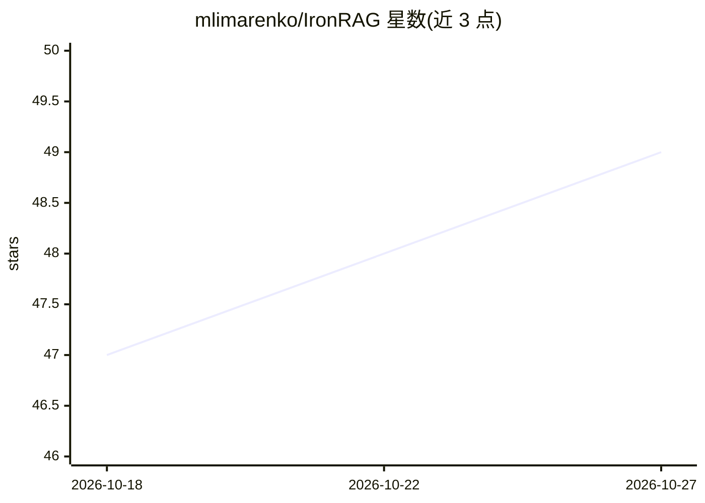

# mlimarenko/IronRAG

⭐ 49 · Rust · MIT · 推送 2026-10-19 · [GitHub](https://github.com/mlimarenko/IronRAG) · 个人维护

**自托管文档检索与带引用落地回答系统，供团队与 AI agent 使用**

面向团队和 AI agent 的自托管知识系统：通过 Docker Compose（PostgreSQL+pgvector、Redis、后端、worker、前端）或 Kubernetes Helm 部署，数据留在本地服务器。能力包括类型化知识图谱与向量/词法/图/技术事实四路混合检索、带 chunk 级引用的落地回答、23 个工具的内置 MCP 服务器、多租户 IAM 与审计日志、连接器（Confluence/BookStack/YouTrack/Git 等）。模型层厂商无关：OpenAI、DeepSeek、Qwen/DashScope、Ollama、LiteLLM 等均可用，八个绑定用途按阶段切换模型。安装经 install.sh 向导或源码运行，首次启动必须配置凭据主密钥。

## 筛选速览

| 维度 | 判定 | 备注 |
|---|---|---|
| AI 角色 | `ai-native` | 本体是模型或模型工具 |
| 许可风险 | `permissive` | MIT |
| 部署形态 | `self-host` | docker 或自建部署 |
| 模型依赖 | local-ok | 支持本地模型 |
| 硬件要求 | — | 无带数字的原话,不猜 |
| 安装摩擦 | `low` | 无编译、无系统依赖或容器化 |
| 成熟度 | — | 结构信号不足 |

## 能力要点

- 向量/词法/图/技术事实四路混合检索与 chunk 级引用落地回答
- 内置 MCP 服务器（23 个工具），兼容 Claude Desktop、Cursor、Zed 等客户端
- 厂商无关模型绑定（OpenAI/DeepSeek/Qwen/Ollama/LiteLLM 等），八种绑定用途
- 多租户 IAM、scoped token、审计日志与 tar.zst 备份恢复

## 适用场景

- 团队私有部署文档知识库并获得带引用的回答
- 为 Claude Desktop、Cursor 等 MCP 客户端提供文档检索与落地回答工具
- 接入 Confluence/BookStack/Git 仓库等内部数据源构建知识图谱

## 场景标签

`RAG` `文档问答` `知识图谱` · 领域:知识与检索

## 证据(README 行号)

> L4:  Self-hosted document search and grounded answers for teams and AI agents.
> L44: - **Provider-agnostic AI** — OpenAI, DeepSeek, Qwen / DashScope, GPTunnel, OpenRouter, RouterAI, MiniMax, Ollama, L
> L67: 3. **Query** — hybrid retrieval (vector, lexical, graph, facts) → grounded answer with citations

## 星数曲线

2026-10-18 47 → 2026-10-27 49（+2）

---
*卡片 v1 · prompt 1.4 · 生成 2026-10-25 · 置信度 high · 依据 README sha `bb9157581db5` · [字段定义](../../DATASET.md)*
