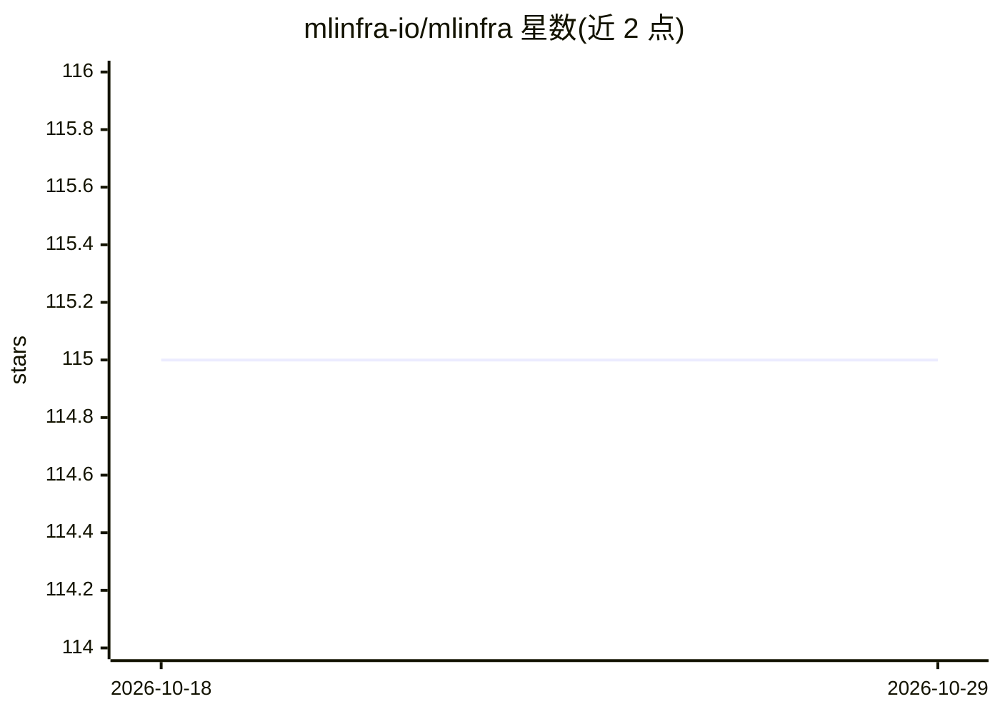

# mlinfra-io/mlinfra

⭐ 115 · Python · Apache-2.0 · 推送 2026-10-28 · [GitHub](https://github.com/mlinfra-io/mlinfra) · [官网](https://mlinfra.io/) · 组织维护

**一条命令在多云与本地部署 MLOps 基础设施的工具**

开源 Python 包 mlinfra，以声明式 YAML 配置驱动，借助 Terraform 将 MLOps 工具栈部署到云端或本地环境。面向需要搭建 ML 基础设施的 ML/平台团队，目标是解耦通常绑定在其他框架中的 IaC 逻辑。当前本地运行时已支持 kind 与 minikube，云端已支持 AWS，GCP/Azure 等在其路线图中；计划覆盖数据摄取、版本控制、向量数据库、推理、监控等 MLOps 各层工具。运行要求系统安装 Terraform >= 1.10.2。

## 筛选速览

| 维度 | 判定 | 备注 |
|---|---|---|
| AI 角色 | `ai-ecosystem` | LLM/agent 周边工具 |
| 许可风险 | `permissive` | Apache-2.0 |
| 部署形态 | `self-host` | docker 或自建部署 |
| 模型依赖 | — | README 未给出锁定关系 |
| 硬件要求 | — | 无带数字的原话,不猜 |
| 安装摩擦 | `low` | 无编译、无系统依赖或容器化 |
| 成熟度 | — | 结构信号不足 |

## 能力要点

- 声明式 YAML 配置 + mlinfra terraform apply 一条命令部署
- 计划支持多云（AWS/GCP/Azure/Oracle 等）与本地（kind/minikube/k3s）
- 规划覆盖 data_ingestion 到 monitoring 的完整 MLOps 工具层
- 基于 Terraform IaC，Python 胶水代码组织

## 适用场景

- ML 团队快速搭建云端 MLOps 工具栈
- 本地 kind/minikube 环境开发验证 MLOps 部署
- 用统一配置在多云间迁移 MLOps 基础设施

## 场景标签

`MLOps` · 领域:训练与推理

## 证据(README 行号)

> L22: `mlinfra` is the swiss army knife for deploying MLOps tooling anywhere. It aims to make MLOps infrastructure deploy
> L93: `mlinfra` intends to support as many MLOps tools deployable in a platform in their standalone as well as high avail

## 星数曲线

2026-10-18 115 → 2026-10-29 115（+0）

---
*卡片 v1 · prompt 1.4 · 生成 2026-10-23 · 置信度 mid · 依据 README sha `49915b037d7b` · [字段定义](../../DATASET.md)*
