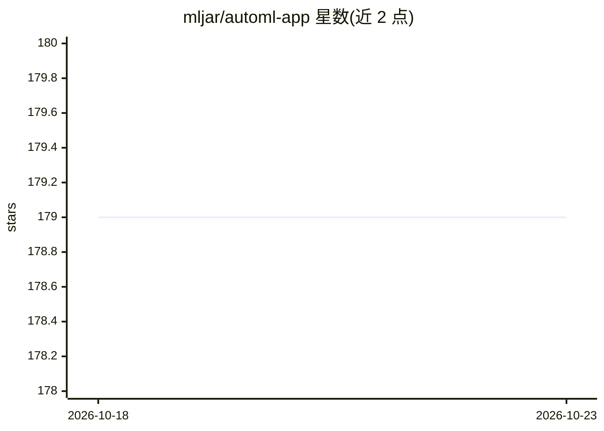

# mljar/automl-app

⭐ 179 · Jupyter Notebook · MIT · 推送 2026-10-05 · [GitHub](https://github.com/mljar/automl-app) · [官网](https://mljar.com/automl/) · 组织维护

**面向使用者的 AutoML 网页应用：上传 CSV 训练模型并批量预测**

由 MLJAR 维护的 AutoML Web 应用：将三个 Jupyter notebook（基础训练、进阶训练、批量预测）通过 Mercury 转为浏览器应用，底层用 mljar-supervised 包训练表格数据的分类/回归模型。用户在网页中上传 CSV（默认 1MB 上限）、选择特征与目标列、算法与训练时限（60/120/240/300 秒可选），查看 AutoML 报告并下载模型 ZIP；预测 notebook 重新加载实验并调用 automl.predict_all() 输出 predictions.csv。本地运行需克隆仓库、建虚拟环境并安装 requirements 后以 mercury run 启动；Optuna 模式未在 notebook 控件中暴露。

## 筛选速览

| 维度 | 判定 | 备注 |
|---|---|---|
| AI 角色 | `ai-native` | 本体是模型或模型工具 |
| 许可风险 | `permissive` | MIT |
| 部署形态 | `library` | 以包/库形式分发 |
| 模型依赖 | — | README 未给出锁定关系 |
| 硬件要求 | — | 无带数字的原话,不猜 |
| 安装摩擦 | `low` | 无编译、无系统依赖或容器化 |
| 成熟度 | — | 结构信号不足 |

## 能力要点

- 三个 notebook 转为浏览器应用：训练、进阶训练、批量预测
- 上传 CSV 即可完成特征选择、算法选择与模型训练，下载模型 ZIP
- 训练模式 Explain/Perform/Compete，训练时限 60-300 秒可选
- 可修改 notebook 单元格调整上传上限与训练时限

## 适用场景

- 不想写代码，在浏览器里上传 CSV 训练分类/回归模型
- 下载训练好的模型 ZIP 做批量预测并获取 predictions.csv
- 本地搭建一个可分享的 AutoML 训练与预测网页应用

## 场景标签

`模型训练` · 领域:训练与推理

## 证据(README 行号)

> L17: Train machine learning models from a CSV file, inspect the results, and download a model archive for batch predicti
> L29: |Train AutoML|Upload training data, choose features and a target, select a training mode and algorithms, and downlo
> L85: The prediction notebook reloads the saved experiment and calls `automl.predict_all()` on the uploaded data.

## 星数曲线

2026-10-18 179 → 2026-10-23 179（+0）

---
*卡片 v1 · prompt 1.4 · 生成 2026-10-22 · 置信度 mid · 依据 README sha `ca07b569d961` · [字段定义](../../DATASET.md)*
