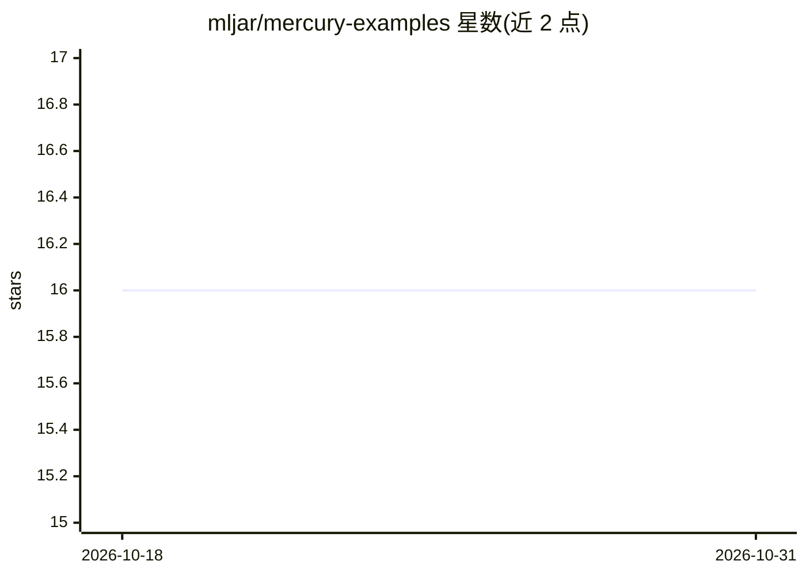

# mljar/mercury-examples

⭐ 16 · Jupyter Notebook · MIT · 推送 2026-09-18 · [GitHub](https://github.com/mljar/mercury-examples) · [官网](https://RunMercury.com/examples/) · 组织维护

**Mercury 框架的数据应用示例 Notebook 集合**

由 MLJAR 维护的示例仓库，收录基于 Mercury 框架构建的数据应用：每个示例以 Python Notebook 形式提供，可通过 mercury 命令发布为交互式 Web 应用。示例覆盖活动日历（Tech layoffs、GitHub incidents）、招聘漏斗、编程语言 Sankey 图、透视表、交互地图，以及将一条 prompt 同时发送给四个可选模型并流式对比回答的 Open Model Arena。README 不含模型实现细节，各示例需进入对应文件夹按其 README 操作，依赖 Python 与 Mercury。

## 筛选速览

| 维度 | 判定 | 备注 |
|---|---|---|
| AI 角色 | `ai-knowledge` | 知识聚合/清单类 |
| 许可风险 | `permissive` | MIT |
| 部署形态 | `None` |  |
| 模型依赖 | — | README 未给出锁定关系 |
| 硬件要求 | — | 无带数字的原话,不猜 |
| 安装摩擦 | `low` | 无编译、无系统依赖或容器化 |
| 成熟度 | — | 结构信号不足 |

## 能力要点

- Notebook 一键转为交互式 Web 应用（mercury 命令）
- 涵盖日历、漏斗、Sankey、透视表、地图等数据应用示例
- Open Model Arena 示例同时向四个可选模型发送同一 prompt 并流式对比

## 适用场景

- 学习如何用 Mercury 把 Notebook 发布为 Web 应用
- 参考交互式数据可视化的实现方式
- 查看多模型同题回答对比应用的示例做法

## 场景标签

`教程课程` `数据分析` · 领域:效率与自动化

## 证据(README 行号)

> L3: Welcome! This repository contains simple examples of data apps built with
> L4: Mercury. Each example starts as a Python notebook and
> L23: - Open Model Arena sends one prompt to four selectable models

## 星数曲线

2026-10-18 16 → 2026-10-31 16（+0）

---
*卡片 v1 · prompt 1.4 · 生成 2026-10-30 · 置信度 high · 依据 README sha `32810113eab3` · [字段定义](../../DATASET.md)*
