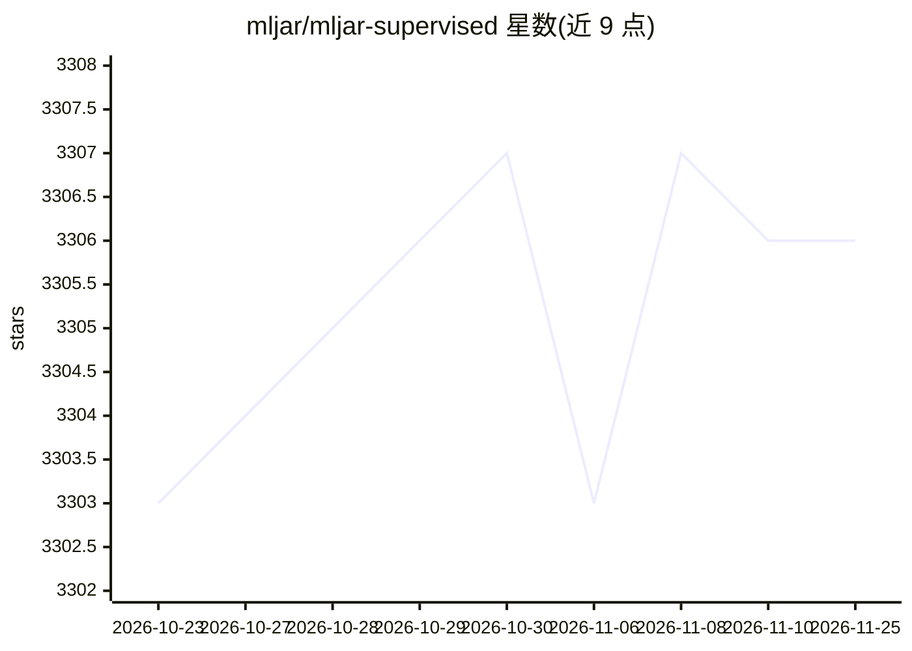

# mljar/mljar-supervised

⭐ 3,306 · Python · MIT · 推送 2026-11-05 · [GitHub](https://github.com/mljar/mljar-supervised) · [官网](https://mljar.com) · 组织维护

**表格数据 AutoML Python 库：自动训练、调参并生成报告**

面向表格数据的 AutoML Python 包：自动完成特征工程、超参调优、模型训练与对比，输出排行榜、模型报告（特征重要性、学习曲线、混淆矩阵、SHAP 解释）及 Markdown/JSON 结构化报告。内置线性模型、随机森林、XGBoost、LightGBM、CatBoost 等经典算法，可选安装 RealMLP、TabM 神经后端与 Kumo、TabICLv2 表格基础模型后端。支持公平性评估与重加权训练、分组验证、自定义指标，可将训练好的模型导出为本地网页预测应用。需 Python 3.11+。

## 筛选速览

| 维度 | 判定 | 备注 |
|---|---|---|
| AI 角色 | `ai-native` | 本体是模型或模型工具 |
| 许可风险 | `permissive` | MIT |
| 部署形态 | `library` | 以包/库形式分发 |
| 模型依赖 | — | README 未给出锁定关系 |
| 硬件要求 | — | 无带数字的原话,不猜 |
| 安装摩擦 | `medium` | 含编译或系统依赖之一 |
| 成熟度 | — | 结构信号不足 |

## 能力要点

- 四档模式（Explain/Perform/Compete/Optuna）控制搜索预算
- 自动报告：排行榜、SHAP 解释、特征重要性，可导出 Markdown/JSON
- 可选后端：RealMLP、TabM、Kumo、TabICLv2 表格基础模型
- 公平性指标与重加权训练、分组验证、自定义损失函数

## 适用场景

- 在 CSV 表格数据上快速训练分类/回归模型并对比
- 自动生成可交付的模型解释文档与报告
- 检测并缓解模型对敏感群体的偏差
- 把训练好的模型导出成本地网页预测应用

## 场景标签

`数据分析` · 领域:效率与自动化

## 证据(README 行号)

> L5:  A Python AutoML package to train models, discover features, and explain predictions.
> L23: |Classic machine learning|Linear models, Random Forest, XGBoost, LightGBM, CatBoost|Included in the base install|
> L249: |Mode|Starting point for|

## 星数曲线

2026-10-23 3,303 → 2026-11-25 3,306（+3）

---
*卡片 v1 · prompt 1.4 · 生成 2026-11-23 · 置信度 high · 依据 README sha `26589f7f0005` · [字段定义](../../DATASET.md)*
