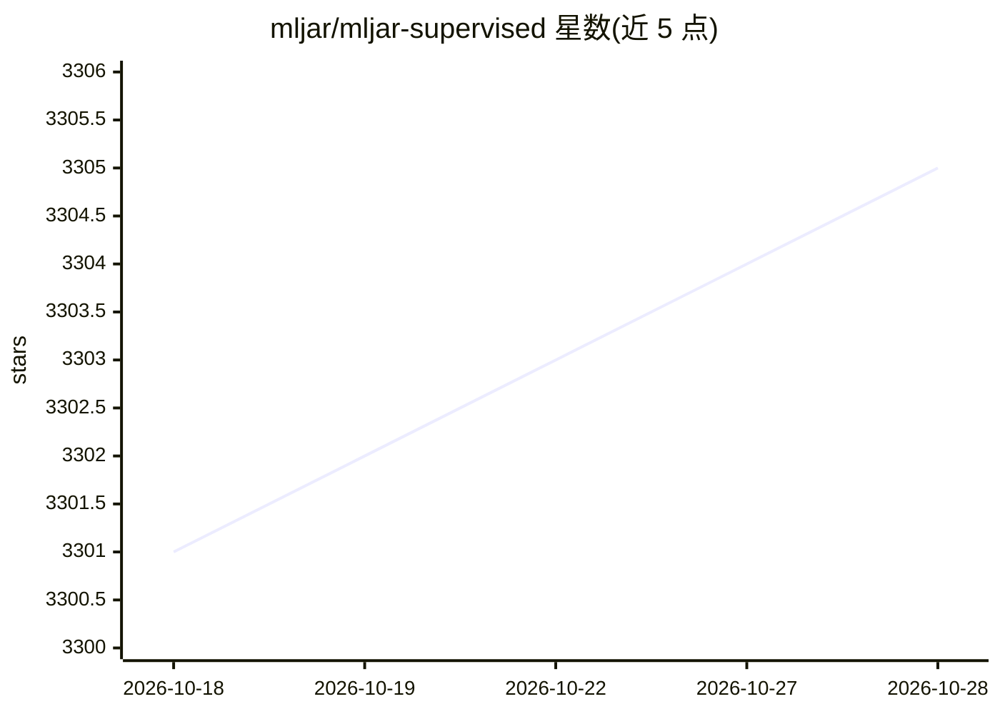

# mljar/mljar-supervised

⭐ 3,306 · Python · MIT · 推送 2026-10-28 · [GitHub](https://github.com/mljar/mljar-supervised) · [官网](https://mljar.com) · 组织维护

**面向表格数据的 Python AutoML 库：自动建模调参与报告**

mljar-supervised 是处理表格数据的 AutoML Python 包，面向数据科学家：自动完成预处理、特征工程、多算法训练（Baseline/Linear/Random Forest/LightGBM/Xgboost/CatBoost/神经网络等）、超参数调优、集成与堆叠，并为每个模型生成 Markdown 报告与 SHAP/特征重要性解释。提供 Explain/Perform/Compete/Optuna 四种工作模式，训练后可基于 Mercury 自动生成交互式预测 Web 应用；自 1.0.0 起支持传入敏感特征的公平性感知训练。模型自动保存与断点续训。

## 筛选速览

| 维度 | 判定 | 备注 |
|---|---|---|
| AI 角色 | `ai-native` | 本体是模型或模型工具 |
| 许可风险 | `permissive` | MIT |
| 部署形态 | `library` | 以包/库形式分发 |
| 模型依赖 | — | README 未给出锁定关系 |
| 硬件要求 | — | 无带数字的原话,不猜 |
| 安装摩擦 | `high` | 编译与系统依赖俱全 |
| 成熟度 | — | 结构信号不足 |

## 能力要点

- 9 类算法自动训练、集成与堆叠，四种内置模式（Explain/Perform/Compete/Optuna）
- 每个模型自动生成 Markdown 报告与 SHAP/置换特征重要性解释
- 训练后可自动生成本地或可发布的 Mercury 预测 Web 应用
- 公平性感知训练：fairness_metric、敏感特征与两种偏差缓解方法
- Kumo/TabICLv2 算法需可选 [tfm] 依赖与 SDM 后端，Python 3.11+

## 适用场景

- 我有一份 CSV 表格数据，想自动训练并挑选最优模型
- 想为每个模型生成可解释报告与 SHAP 分析
- 训练完成后把模型分享给不懂代码的业务同事做预测
- 需要在训练中使用敏感特征并控制模型公平性

## 场景标签

`数据分析` · 领域:效率与自动化

## 证据(README 行号)

> L33: The `mljar-supervised` is an Automated Machine Learning Python package that works with tabular data. It is designed
> L37:  - trying many different machine learning models (Algorithm Selection and Hyper-Parameters tuning),

## 星数曲线

2026-10-18 3,301 → 2026-10-28 3,305（+4）

---
*卡片 v1 · prompt 1.4 · 生成 2026-10-20 · 置信度 high · 依据 README sha `f93d7976ad54` · [字段定义](../../DATASET.md)*
