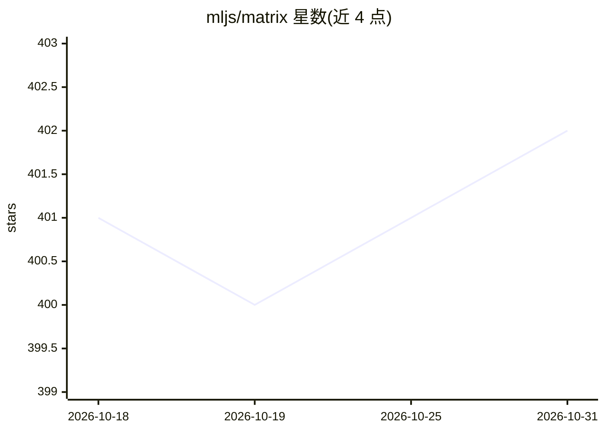

# mljs/matrix

⭐ 402 · JavaScript · MIT · 推送 2026-10-19 · [GitHub](https://github.com/mljs/matrix) · [官网](https://mljs.github.io/matrix/) · 组织维护

**面向 JavaScript/Node.js 的矩阵运算与线性代数库**

mljs 生态下的矩阵操作与计算库，以 npm 包 ml-matrix 提供：支持 ES module 与 CommonJS 两种引入方式，功能覆盖矩阵的创建（zeros/ones/eye）、标准与原地算术运算、Math 逐元素函数、行列归约、拼接、转置等操纵操作，以及逆/伪逆、最小二乘求解、QR/LU/Cholesky 分解、特征值与特征向量、线性相关性检查等数值计算。面向在 JavaScript 环境中实现数值算法与机器学习方法的开发者，MIT 许可。

## 筛选速览

| 维度 | 判定 | 备注 |
|---|---|---|
| AI 角色 | `ai-ecosystem` | LLM/agent 周边工具 |
| 许可风险 | `permissive` | MIT |
| 部署形态 | `library` | 以包/库形式分发 |
| 模型依赖 | — | README 未给出锁定关系 |
| 硬件要求 | — | 无带数字的原话,不猜 |
| 安装摩擦 | `low` | 无编译、无系统依赖或容器化 |
| 成熟度 | — | 结构信号不足 |

## 能力要点

- 矩阵创建与算术/原地运算、逐元素 Math 函数
- 逆矩阵/伪逆与最小二乘求解
- QR、LU、Cholesky 分解及特征值/特征向量计算
- 同时支持 ES module 与 CommonJS 引入

## 适用场景

- 在 Node.js 或浏览器中做线性代数运算
- 为机器学习/统计算法提供矩阵底层支持
- 求解最小二乘或矩阵分解类数值问题

## 场景标签

 · 领域:科学计算/机器学习基础库

## 证据(README 行号)

> L3: Matrix manipulation and computation library.
> L18: `$ npm install ml-matrix`

## 星数曲线

2026-10-18 401 → 2026-10-31 402（+1）

---
*卡片 v1 · prompt 1.4 · 生成 2026-10-21 · 置信度 mid · 依据 README sha `8fd5cd324bf2` · [字段定义](../../DATASET.md)*
