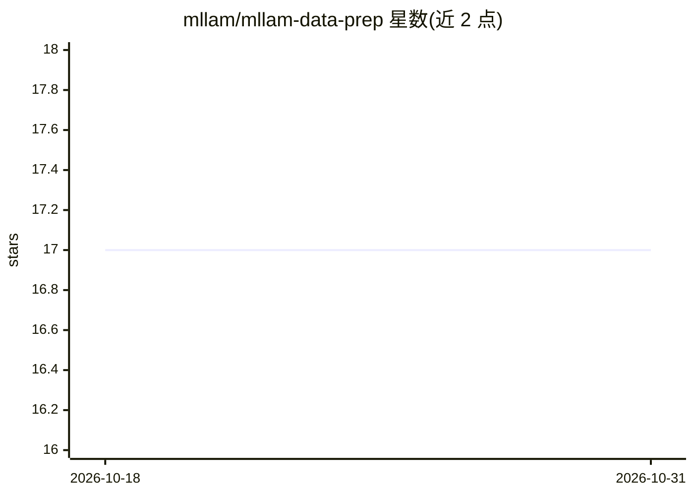

# mllam/mllam-data-prep

⭐ 17 · Python · 推送 2026-10-25 · [GitHub](https://github.com/mllam/mllam-data-prep) · [官网](https://kutt.to/mllam) · 组织维护

**用声明式 YAML 配置生成 ML 天气预报模型训练数据集**

面向数据驱动机器学习天气预报模型的数据准备工具：在 YAML 配置文件中声明数据源、提取变量、维度映射（rename/stack 等方法）与目标模型架构的输入变量，生成 zarr 格式训练数据集。支持数据集切分与统计量计算（mean/std/diff_mean 等）、基于凸包的区域裁剪（面向有限区域模式边界数据）、通过 dask.distributed 并行构建。提供 CLI 与 Python 模块两种用法，源数据可为本地路径或 xarray 可读的 URL。

## 筛选速览

| 维度 | 判定 | 备注 |
|---|---|---|
| AI 角色 | `ai-ecosystem` | LLM/agent 周边工具 |
| 许可风险 | `none` | — |
| 部署形态 | `library` | 以包/库形式分发 |
| 模型依赖 | — | README 未给出锁定关系 |
| 硬件要求 | — | 无带数字的原话,不猜 |
| 安装摩擦 | `low` | 无编译、无系统依赖或容器化 |
| 成熟度 | — | 结构信号不足 |

## 能力要点

- 声明式 YAML 定义数据源到模型输入的维度映射
- 输出 zarr 训练数据集，支持 train/val/test 切分与统计量计算
- 基于另一数据集凸包的区域裁剪（LAM 边界强迫场景）
- dask.distributed 并行构建大型数据集

## 适用场景

- 为机器学习天气预报模型准备结构匹配的训练数据
- 从全球再分析数据裁剪生成有限区域模式的边界数据集
- 训练期间以 Python 模块方式按需生成数据集

## 场景标签

`MLOps` · 领域:训练与推理

## 证据(README 行号)

> L3: This package aims to be a *declarative* way to prepare training-data for data-driven (i.e. machine learning) weather
> L51: The package is designed to be used as a command-line tool. The main command is `mllam-data-prep` which takes a conf
> L93: The package can also be used as a python module to create datasets directly, for example to create training dataset

## 星数曲线

2026-10-18 17 → 2026-10-31 17（+0）

---
*卡片 v1 · prompt 1.4 · 生成 2026-10-29 · 置信度 high · 依据 README sha `e3d5c93686fe` · [字段定义](../../DATASET.md)*
