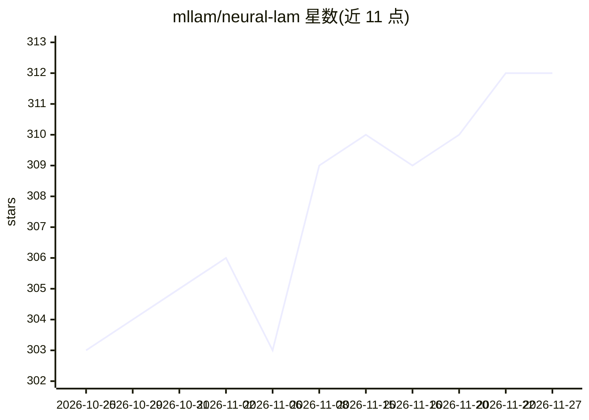

# mllam/neural-lam

⭐ 312 · Python · MIT · 推送 2026-11-26 · [GitHub](https://github.com/mllam/neural-lam) · [官网](https://kutt.to/mllam) · 组织维护

**面向研究者的有限区域图神经网络天气预报模型库**

基于 PyTorch、PyTorch Lightning 和 PyG 构建的图神经网络天气预报研究软件，面向有限区域建模（LAM）。提供模块化、可替换的数据、图与模型组件，实现 Graph-LAM、Hi-LAM、Hi-LAM-Parallel 三种架构，支持确定性预报与概率集合预报。使用前需准备配置文件、datastore 和图结构；训练与评估通过 CLI 或 Python API 完成。安装支持 PyPI、CUDA 变体及可编辑安装，文档站点含教程与 API 参考。

## 筛选速览

| 维度 | 判定 | 备注 |
|---|---|---|
| AI 角色 | `ai-native` | 本体是模型或模型工具 |
| 许可风险 | `permissive` | MIT |
| 部署形态 | `library` | 以包/库形式分发 |
| 模型依赖 | — | README 未给出锁定关系 |
| 硬件要求 | — | 无带数字的原话,不猜 |
| 安装摩擦 | `medium` | 含编译或系统依赖之一 |
| 成熟度 | — | 结构信号不足 |

## 能力要点

- 三种图神经网络架构：Graph-LAM（扁平）、Hi-LAM（分层）、Hi-LAM-Parallel
- 模型、图、数据三层独立，各组件可替换
- 支持确定性预报与采样集合的概率预报
- 提供训练/评估 CLI 与配置、datastore、图创建的用户指南

## 适用场景

- 在自己区域的气象数据上训练 GNN 有限区域预报模型
- 复现 NeurIPS 2023/2024 相关论文的实验结果
- 扩展新的 StepPredictor 或预报器类做模型研究
- 按 DANRA 教程跑通小例子并绘图评估

## 场景标签

 · 领域:科研/气象机器学习

## 证据(README 行号)

> L5: Neural-LAM is a repository of graph-based neural weather prediction models for Limited Area Modeling (LAM).
> L8: It is aimed at researchers and engineers working on ML-based numerical weather prediction who want to train, evaluat
> L24: The three implemented architectures are Graph-LAM (flat), Hi-LAM (hierarchical), and Hi-LAM-Parallel.

## 星数曲线

2026-10-25 303 → 2026-11-27 312（+9）

---
*卡片 v1 · prompt 1.4 · 生成 2026-11-25 · 置信度 high · 依据 README sha `0cf7dec0b1a3` · [字段定义](../../DATASET.md)*
