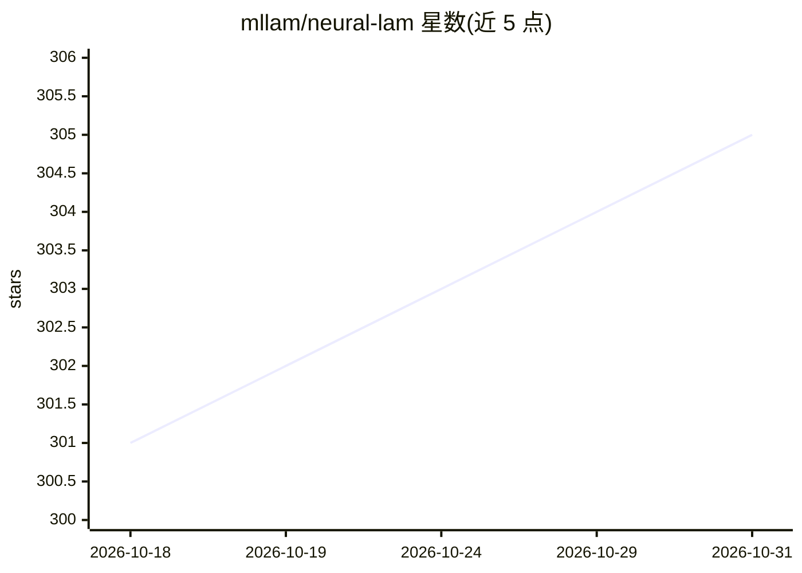

# mllam/neural-lam

⭐ 305 · Python · MIT · 推送 2026-10-30 · [GitHub](https://github.com/mllam/neural-lam) · [官网](https://kutt.to/mllam) · 组织维护

**有限区域气象预报的图神经网络建模研究代码库**

面向区域（LAM）数值天气预报的图神经网络研究与训练代码库，基于 PyTorch / PyTorch Lightning / PyG 实现，收录 Keisler (2022)、GraphCast、Oskarsson 等 (2023) 模型的 LAM 版本。采用模块化设计：模型、图结构与数据（datastore）分离存储，可替换组件。通过 config.yaml 配置 datastore（zarr/numpy 等格式）与损失权重，流程为预处理、生成图、训练/评估。全球与概率模型尚未合并入 main（见 issues 62/63），保留论文专用分支以复现结果。

## 筛选速览

| 维度 | 判定 | 备注 |
|---|---|---|
| AI 角色 | `ai-native` | 本体是模型或模型工具 |
| 许可风险 | `permissive` | MIT |
| 部署形态 | `library` | 以包/库形式分发 |
| 模型依赖 | — | README 未给出锁定关系 |
| 硬件要求 | — | 无带数字的原话,不猜 |
| 安装摩擦 | `medium` | 含编译或系统依赖之一 |
| 成熟度 | — | 结构信号不足 |

## 能力要点

- 收录 Keisler (2022)、GraphCast、层次化模型的 LAM 实现
- 模型/图/数据（datastore）模块化分离，组件可替换
- 支持 state/forcing/static 三类变量与 interior/boundary 双 datastore 配置
- 保留论文专用分支用于复现发表结果

## 适用场景

- 在有限区域气象数据上训练图神经网络预报模型
- 复现 Neural-LAM 相关论文实验结果
- 通过自定义 datastore 接入自己的气象数据源

## 场景标签

`模型训练` · 领域:训练与推理

## 证据(README 行号)

> L5: Neural-LAM is a repository of graph-based neural weather prediction models for Limited Area Modeling (LAM).
> L7: The code uses PyTorch and PyTorch Lightning.
> L48: The Neural-LAM code is designed to modularize the different components involved in training and evaluating neural w

## 星数曲线

2026-10-18 301 → 2026-10-31 305（+4）

---
*卡片 v1 · prompt 1.4 · 生成 2026-10-21 · 置信度 high · 依据 README sha `2e13f53a5224` · [字段定义](../../DATASET.md)*
