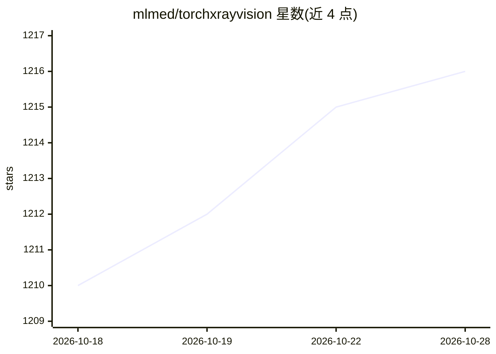

# mlmed/torchxrayvision

⭐ 1,216 · Jupyter Notebook · NOASSERTION · 推送 2026-10-18 · [GitHub](https://github.com/mlmed/torchxrayvision) · [官网](https://mlmed.org/torchxrayvision) · 组织维护

**胸部 X 光数据集与预训练模型的 PyTorch 库，服务医学影像研究**

面向医学影像研究者的开源 Python 库：为多个公开胸部 X 光数据集（NIH、CheXpert、MIMIC、PadChest、RSNA 等）提供统一接口与预处理链，支持合并、过滤与标签对齐；提供 DenseNet121 系列预训练分类模型（18 输出病理预测）、ResNet 自编码器与 PSPNet 解剖分割模型，可用作基线或特征提取器；另含协变量偏移模拟工具用于泛化性研究。通过 pip 安装。

## 筛选速览

| 维度 | 判定 | 备注 |
|---|---|---|
| AI 角色 | `ai-native` | 本体是模型或模型工具 |
| 许可风险 | `none` | NOASSERTION |
| 部署形态 | `library` | 以包/库形式分发 |
| 模型依赖 | — | README 未给出锁定关系 |
| 硬件要求 | — | 无带数字的原话,不猜 |
| 安装摩擦 | `low` | 无编译、无系统依赖或容器化 |
| 成熟度 | — | 结构信号不足 |

## 能力要点

- 多数据集统一接口，可单行代码切换与合并
- DenseNet121 预训练分类模型（18 病理输出）
- 预训练自编码器（ResNetAE）与解剖分割模型（PSPNet，14 目标）
- CovariateDataset 协变量偏移模拟工具用于泛化研究

## 适用场景

- 用预训练模型快速对大规模胸片数据集做病理预测
- 跨多个外部数据集稳健评估算法泛化能力
- 胸片特征提取用于小样本学习
- 复现与构建分布偏移实验研究泛化性

## 场景标签

`目标检测` · 领域:感知与多模态

## 证据(README 行号)

> L14: TorchXRayVision is an open source software library for working with chest X-ray datasets and deep learning models. 
> L38: {'preds': {'Atelectasis': 0.50577986,

## 星数曲线

2026-10-18 1,210 → 2026-10-28 1,216（+6）

---
*卡片 v1 · prompt 1.4 · 生成 2026-10-21 · 置信度 high · 依据 README sha `76dea1b0c9ed` · [字段定义](../../DATASET.md)*
