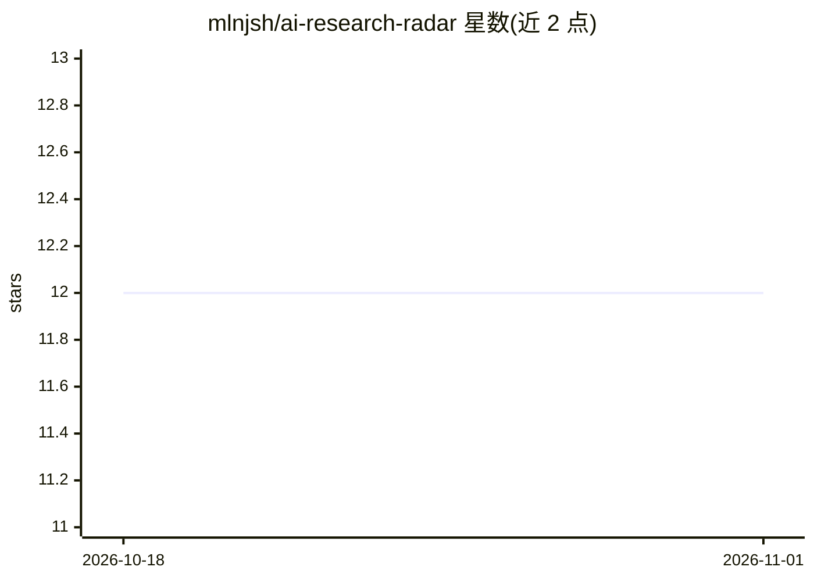

# mlnjsh/ai-research-radar

⭐ 12 · Python · MIT · 推送 2026-10-31 · [GitHub](https://github.com/mlnjsh/ai-research-radar) · 个人维护

**自更新的 arXiv AI 论文追踪器，每 6 小时自动汇总分类**

由 GitHub Actions 驱动的论文追踪仓库：定时抓取 arXiv 多个类别（cs.AI、cs.LG、cs.CL、cs.CV 等）的新论文，自动分类并更新 README，生成趋势主题（近 7 日）、每周摘要（周一 00:00 UTC 生成）与启动以来统计。用户可 fork 仓库、配置 scripts/config.py 中的类别与优先关键词、可选添加 OPENAI_API_KEY 以启用 AI 摘要，并手动或自动触发 scan.yml 工作流。面向需要跟进 AI 研究动态的科研人员与开发者。

## 筛选速览

| 维度 | 判定 | 备注 |
|---|---|---|
| AI 角色 | `ai-knowledge` | 知识聚合/清单类 |
| 许可风险 | `permissive` | MIT |
| 部署形态 | `None` |  |
| 模型依赖 | — | README 未给出锁定关系 |
| 硬件要求 | — | 无带数字的原话,不猜 |
| 安装摩擦 | `low` | 无编译、无系统依赖或容器化 |
| 成熟度 | — | 结构信号不足 |

## 能力要点

- GitHub Actions 每 6 小时自动抓取、汇总并更新论文列表
- 按 8 个 arXiv 类别分类展示，支持自定义优先关键词
- 自动生成趋势主题与每周摘要（200 篇/周量级扫描）
- 可 fork 后自定义类别、关键词与更新频率

## 适用场景

- 我每天想快速浏览 arXiv 最新 AI 论文而不手动刷列表
- 我想按自己的研究方向定制论文追踪类别与关键词
- 我想每周收到一次所在领域的论文摘要

## 场景标签

`科研工具` · 领域:学习与行业

## 证据(README 行号)

> L10: **This README updates itself every 6 hours with the latest AI research papers from arXiv.**
> L12: No manual curation needed. GitHub Actions fetches, summarizes, and categorizes new papers automatically.

## 星数曲线

2026-10-18 12 → 2026-11-01 12（+0）

---
*卡片 v1 · prompt 1.4 · 生成 2026-11-01 · 置信度 high · 依据 README sha `88f8c46d67cb` · [字段定义](../../DATASET.md)*
