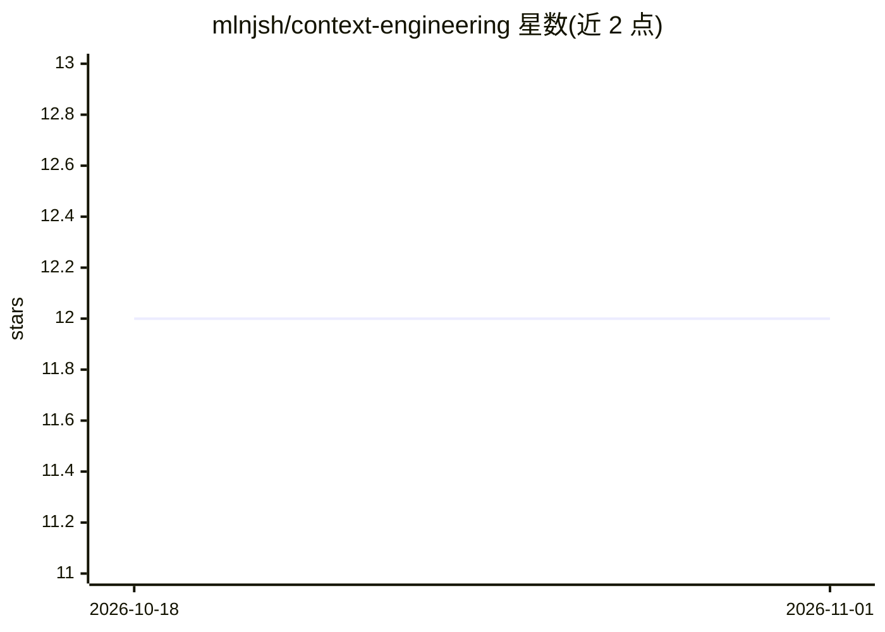

# mlnjsh/context-engineering

⭐ 12 · MIT · 推送 2026-03-25 · [GitHub](https://github.com/mlnjsh/context-engineering) · 组织维护

**LLM 上下文工程研究资源指南：论文/视频/博文/工具清单**

由 Northwestern University 数据科学教授 Milan Amrut Joshi 维护的策展式知识库，围绕 LLM 上下文工程（Context Engineering）学科组织资料：界定上下文工程与提示工程的区别，梳理上下文窗口、token 预算分配、RAG、记忆管理、上下文压缩、信息排序等关键概念，收录 34 篇带标注的研究论文、22 个 YouTube 视频与 14 篇博客文章，另附各模型上下文窗口尺寸对照表。资料为 Markdown 文档形式，无需安装运行，子目录 papers/videos/blogs 内含更详细清单。

## 筛选速览

| 维度 | 判定 | 备注 |
|---|---|---|
| AI 角色 | `ai-knowledge` | 知识聚合/清单类 |
| 许可风险 | `permissive` | MIT |
| 部署形态 | `None` |  |
| 模型依赖 | — | README 未给出锁定关系 |
| 硬件要求 | — | 无带数字的原话,不猜 |
| 安装摩擦 | `low` | 无编译、无系统依赖或容器化 |
| 成熟度 | — | 结构信号不足 |

## 能力要点

- 34 篇按主题分类的研究论文清单（长上下文/RAG/提示优化/记忆管理）
- 22 个视频与 14 篇博文的分级（初/中/高）推荐列表
- 上下文工程 vs 提示工程的概念框架与多维对比表
- 16 个主流模型的上下文窗口尺寸对照表

## 适用场景

- 系统学习 LLM 上下文工程的概念与研究脉络
- 按主题查找 RAG、长上下文、记忆管理方向的论文
- 挑选不同难度级别的视频课程与博客入门材料

## 场景标签

`精选清单` `教程课程` · 领域:学习与行业

## 证据(README 行号)

> L15: *A curated, research-backed guide to the emerging discipline of Context Engineering for Large Language Models.*
> L110: ## 📚 Research Papers
> L17: Papers · Videos · Blog Posts · Tools · Techniques · Courses · Roadmap

## 星数曲线

2026-10-18 12 → 2026-11-01 12（+0）

---
*卡片 v1 · prompt 1.4 · 生成 2026-11-01 · 置信度 high · 依据 README sha `6aa4ba4f7b98` · [字段定义](../../DATASET.md)*
