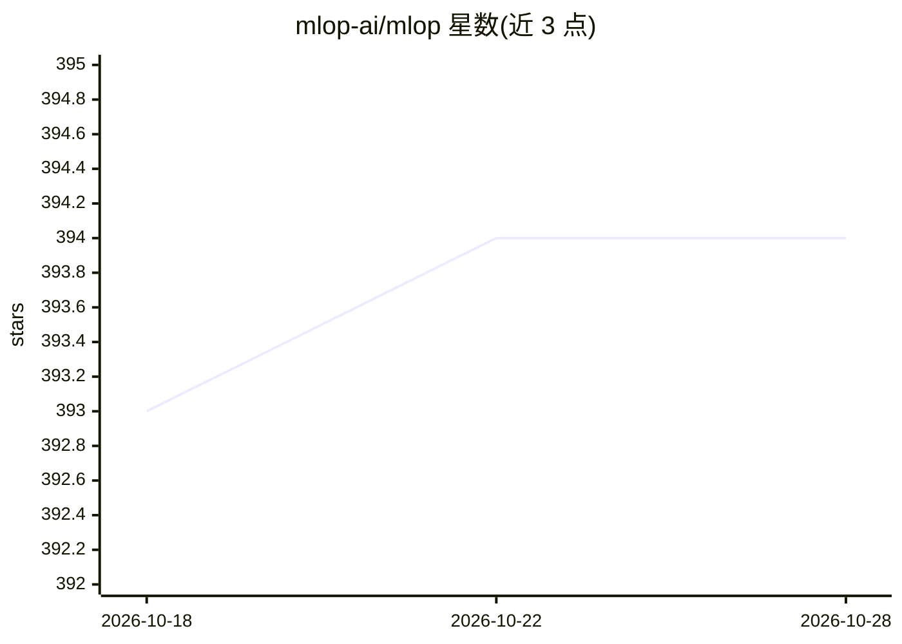

# mlop-ai/mlop

⭐ 394 · Python · Apache-2.0 · 推送 2026-03-05 · [GitHub](https://github.com/mlop-ai/mlop) · [官网](https://mlop.ai) · 组织维护

**面向 ML 工程师的自托管实验跟踪与训练生命周期管理框架**

MLOps 框架，提供可自托管的实验跟踪能力与 ML 模型训练生命周期管理：通过 5 行 Python 代码（mlop.init/log/finish）记录指标，自标榜高且稳定的数据吞吐为首要目标。提供两条使用路径：官方平台 notebook 试用，或通过 docker-compose 三条命令自托管 server（含 git clone 源码）。由 mlop-ai 组织维护，附带入门教程与 torch 教程文档。

## 筛选速览

| 维度 | 判定 | 备注 |
|---|---|---|
| AI 角色 | `ai-ecosystem` | LLM/agent 周边工具 |
| 许可风险 | `permissive` | Apache-2.0 |
| 部署形态 | `library` | 以包/库形式分发 |
| 模型依赖 | — | README 未给出锁定关系 |
| 硬件要求 | — | 无带数字的原话,不猜 |
| 安装摩擦 | `low` | 无编译、无系统依赖或容器化 |
| 成熟度 | — | 结构信号不足 |

## 能力要点

- 5 行 Python 代码接入的实验记录 API
- docker-compose 三命令自托管服务端
- 针对数据吞吐设计的跟踪架构
- 提供平台版与自托管版两种使用路径

## 适用场景

- 跟踪 ML 训练过程中的指标与参数
- 自托管实验跟踪服务避免依赖第三方平台
- 在 notebook 中快速开始记录实验

## 场景标签

`MLOps` · 领域:训练与推理

## 证据(README 行号)

> L8: **mlop** is a Machine Learning Operations (MLOps) framework. It provides self-hostable superior experimental trackin
> L12: **mlop** adopts a KISS philosophy that allows it to outperform all other tools in this category. Supporting high an

## 星数曲线

2026-10-18 393 → 2026-10-28 394（+1）

---
*卡片 v1 · prompt 1.4 · 生成 2026-10-21 · 置信度 high · 依据 README sha `40d317036d04` · [字段定义](../../DATASET.md)*
