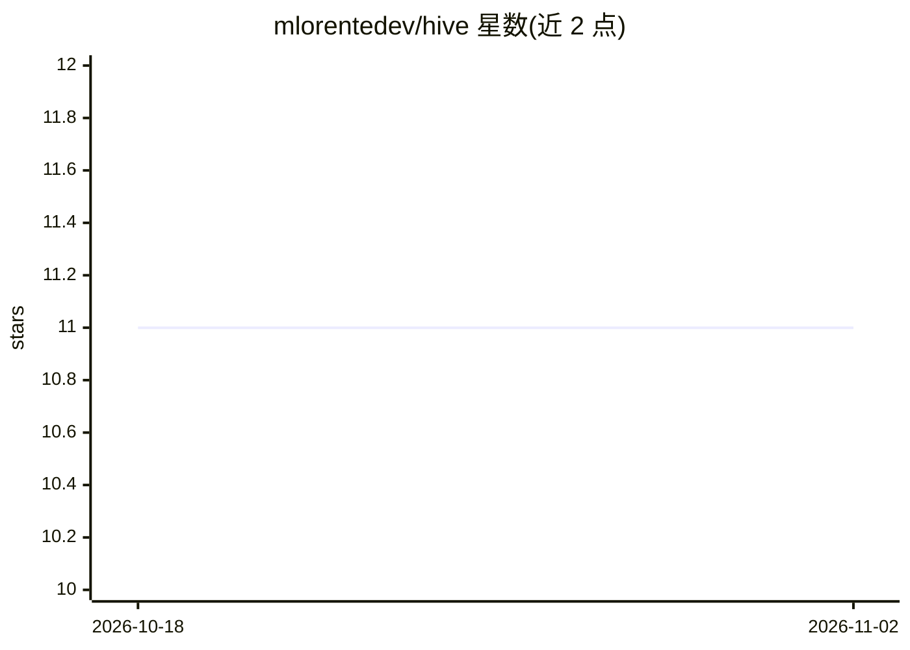

# mlorentedev/hive

⭐ 11 · Python · MIT · 推送 2026-11-01 · [GitHub](https://github.com/mlorentedev/hive) · [官网](https://pypi.org/project/hive-vault/) · 个人维护

**MCP 服务器：让 AI 编程助手按需访问 Obsidian 知识库**

面向 AI 辅助开发的上下文基础设施：作为 MCP 服务器把 AI 助手（Claude Code、Codex CLI、Cursor 等）连接到 Obsidian vault，按需查询而非预载全部内容。提供 13 个工具，覆盖 vault 查询/全文搜索/读写补丁/git 提交、课程捕获与置信度强化（SQLite 存储）、语义问答（可选 embeddings 后端）、任务委派到 OpenAI 兼容端点。需 Python 3.12+，支持 daemon 模式（暂不建议部署于不可信多用户主机）。

## 筛选速览

| 维度 | 判定 | 备注 |
|---|---|---|
| AI 角色 | `ai-ecosystem` | LLM/agent 周边工具 |
| 许可风险 | `permissive` | MIT |
| 部署形态 | `library` | 以包/库形式分发 |
| 模型依赖 | — | README 未给出锁定关系 |
| 硬件要求 | — | 无带数字的原话,不猜 |
| 安装摩擦 | `low` | 无编译、无系统依赖或容器化 |
| 成熟度 | — | 结构信号不足 |

## 能力要点

- 按需加载 vault 上下文的 MCP 服务器（13 个工具 + 5 资源 + 4 提示）
- vault_write/patch/commit 支持 commit=False 批量延迟提交
- 课程强化机制：每次读取提升置信度，SQLite 侧表跨进程安全
- 可选 daemon 模式：单长驻进程持有 vault，客户端经 hive client 接入

## 适用场景

- 让 AI 编程助手跨会话保留项目知识与经验教训
- 把 Obsidian 笔记库接入 Claude Code / Cursor 等 MCP 客户端
- 将低价值任务委派给更便宜的 OpenAI 兼容模型

## 场景标签

`文档问答` · 领域:知识与检索

## 证据(README 行号)

> L16: Hive is an MCP server that connects your AI assistant to an Obsidian vault. Instead of loading everything upfront, 
> L165: MCP Host (Claude Code, Gemini CLI, Codex CLI, Cursor, ...)

## 星数曲线

2026-10-18 11 → 2026-11-02 11（+0）

---
*卡片 v1 · prompt 1.4 · 生成 2026-11-02 · 置信度 high · 依据 README sha `09f39749f252` · [字段定义](../../DATASET.md)*
