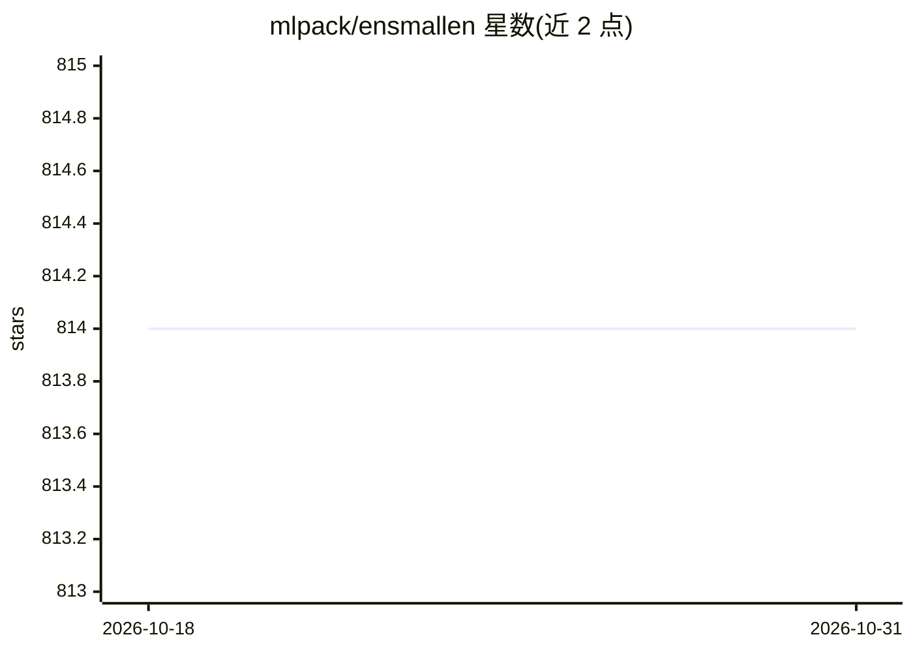

# mlpack/ensmallen

⭐ 814 · C++ · NOASSERTION · 推送 2026-09-11 · [GitHub](https://github.com/mlpack/ensmallen) · [官网](http://ensmallen.org) · 组织维护

**给 C++ 开发者的头文件数值优化函数库**

ensmallen 是 header-only 的 C++ 非线性数值优化库，提供梯度下降类、无梯度优化器与约束优化等多类算法，包括 L-BFGS、SGD、CMAES、模拟退火等，并支持可选回调自定义优化过程。面向需要在 C++ 项目中嵌入优化求解的开发者与科研用户，常作为 mlpack 等机器学习栈的组件。要求 C++14 编译器、Armadillo 10.8.2+ 及 OpenBLAS/Intel MKL/LAPACK，通过 cmake 或手动复制头文件安装。

## 筛选速览

| 维度 | 判定 | 备注 |
|---|---|---|
| AI 角色 | `ai-ecosystem` | LLM/agent 周边工具 |
| 许可风险 | `none` | NOASSERTION |
| 部署形态 | `None` |  |
| 模型依赖 | — | README 未给出锁定关系 |
| 硬件要求 | — | 无带数字的原话,不猜 |
| 安装摩擦 | `medium` | 含编译或系统依赖之一 |
| 成熟度 | — | 结构信号不足 |

## 能力要点

- header-only 设计，仅头文件与 cmake/手动复制两种安装方式
- 涵盖梯度下降、无梯度与约束优化（L-BFGS、SGD、CMAES、模拟退火等）
- 可选回调机制自定义优化过程
- 附 JMLR 2021 论文可供引用

## 适用场景

- 在 C++ 项目中为机器学习模型做参数优化
- 线性回归等场景使用 L-BFGS 求解
- 需要无 root 权限环境部署优化库

## 场景标签

 · 领域:数值优化/机器学习工具库

## 证据(README 行号)

> L1: ensmallen: a C++ header-only library for numerical optimization
> L5: ensmallen provides many types of optimizers that can be used
> L9: Examples include L-BFGS, SGD, CMAES and Simulated Annealing.

## 星数曲线

2026-10-18 814 → 2026-10-31 814（+0）

---
*卡片 v1 · prompt 1.4 · 生成 2026-10-21 · 置信度 high · 依据 README sha `1b4235176b83` · [字段定义](../../DATASET.md)*
