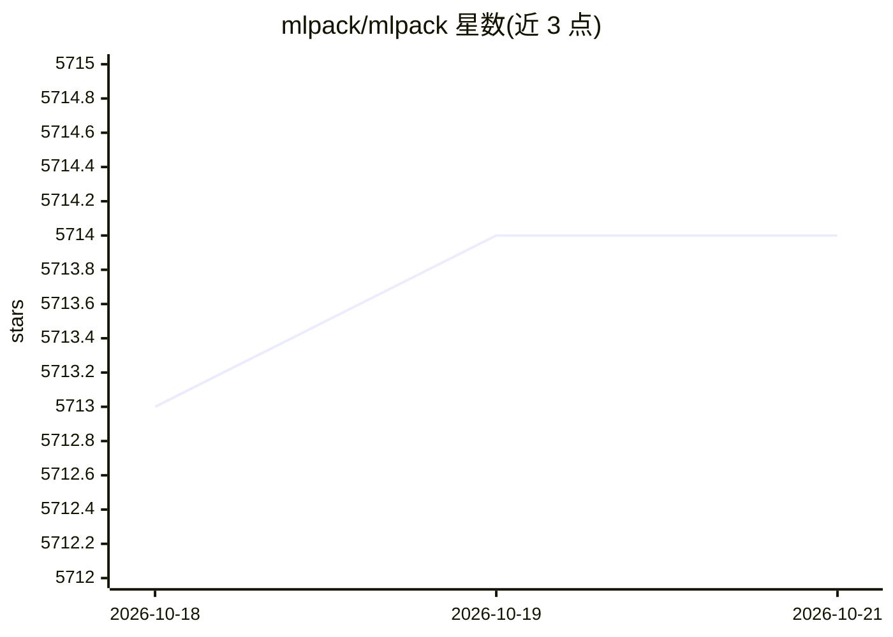

# mlpack/mlpack

⭐ 5,714 · C++ · NOASSERTION · 推送 2026-10-15 · [GitHub](https://github.com/mlpack/mlpack) · [官网](https://www.mlpack.org/) · 组织维护

**C++ 机器学习库：面向研究与生产部署的多语言绑定 ML 工具集**

header-only 的 C++ 机器学习库，定位为机器学习领域的 LAPACK 类基础库，实现多种机器学习方法（如回归、最近邻搜索、神经网络等）。除 C++ 接口外提供命令行程序及 Python、Julia、Go、R 绑定，可用于生产部署与交互式原型（C++ notebook）。依赖 C++17 编译器及 Armadillo、ensmallen、cereal 库；编译安装（make install），自带 STB/httplib/dr_libs 头文件库支持图像与音频加载。由 NumFOCUS 赞助，采用开放治理模型，附 JOSS 论文供引用。

## 筛选速览

| 维度 | 判定 | 备注 |
|---|---|---|
| AI 角色 | `ai-native` | 本体是模型或模型工具 |
| 许可风险 | `none` | NOASSERTION |
| 部署形态 | `None` |  |
| 模型依赖 | — | README 未给出锁定关系 |
| 硬件要求 | — | 无带数字的原话,不猜 |
| 安装摩擦 | `medium` | 含编译或系统依赖之一 |
| 成熟度 | — | 结构信号不足 |

## 能力要点

- header-only C++ 实现，适合部署与生产环境
- 提供 Python/Julia/Go/R 绑定与命令行程序
- 依赖 Armadillo/ensmallen/cereal，C++17 编译
- JOSS 2023 论文（doi:10.21105/joss.05026）

## 适用场景

- 在 C++ 项目中直接集成各类机器学习算法
- 通过 Python/Julia/Go/R 绑定使用 mlpack
- 研究与教学中引用并复现机器学习方法

## 场景标签

 · 领域:机器学习/科学计算

## 证据(README 行号)

> L16: **mlpack** is an intuitive, fast, and flexible header-only C++ machine learning
> L25: In addition to its powerful C++ interface, mlpack also provides command-line

## 星数曲线

2026-10-18 5,713 → 2026-10-21 5,714（+1）

---
*卡片 v1 · prompt 1.4 · 生成 2026-10-20 · 置信度 high · 依据 README sha `06b24869f58f` · [字段定义](../../DATASET.md)*
