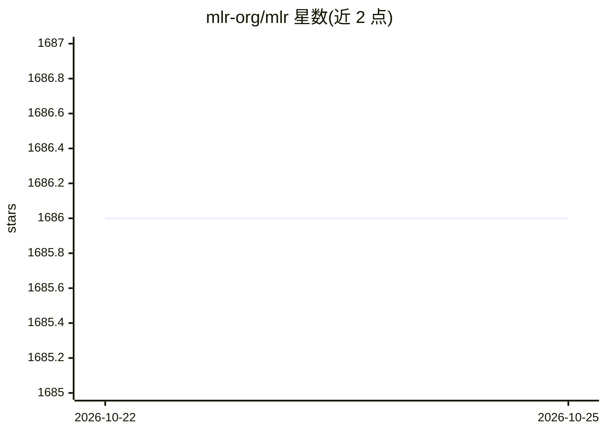

# mlr-org/mlr

⭐ 1,686 · R · NOASSERTION · 推送 2026-10-11 · [GitHub](https://github.com/mlr-org/mlr) · [官网](https://mlr.mlr-org.com) · 组织维护

**R 语言机器学习实验框架（已退役），统一接口调用与评测算法**

为 R 提供机器学习基础框架：以统一 S3 接口封装 R 的分类、回归、聚类与生存分析算法，提供重采样（交叉验证/自助/子采样）、超参数优化（irace、序贯基于模型优化）、特征选择、不平衡校正、基准比较、可视化与内置并行化。已声明退役：不再新增功能，仅修复严重缺陷，官方建议改用 mlr3 框架。通过 CRAN install.packages 安装，支持扩展自定义学习器与数据挖掘链。给需要统一实验流程的 R 用户使用。

## 筛选速览

| 维度 | 判定 | 备注 |
|---|---|---|
| AI 角色 | `ai-ecosystem` | LLM/agent 周边工具 |
| 许可风险 | `none` | NOASSERTION |
| 部署形态 | `None` |  |
| 模型依赖 | — | README 未给出锁定关系 |
| 硬件要求 | — | 无带数字的原话,不猜 |
| 安装摩擦 | `low` | 无编译、无系统依赖或容器化 |
| 成熟度 | — | 结构信号不足 |

## 能力要点

- 统一 S3 接口封装 R 的分类/回归/聚类/生存分析算法
- 重采样、嵌套重采样与基准比较
- 超参数优化（irace、序贯基于模型优化）与特征选择（过滤/包装）
- 不平衡校正、代价敏感学习与内置并行化

## 适用场景

- 在 R 中以统一接口运行和比较多种机器学习算法
- 做带超参数调优与特征选择的嵌套重采样实验
- 通过 OpenML 连接器共享数据集与实验

## 场景标签

`模型评测` `MLOps` · 领域:评测与运维

## 证据(README 行号)

> L68: {mlr} provides this infrastructure so that you can focus on your experiments!
> L69: The framework provides supervised methods like classification, regression and survival analysis along with their co

## 星数曲线

2026-10-22 1,686 → 2026-10-25 1,686（+0）

---
*卡片 v1 · prompt 1.4 · 生成 2026-10-21 · 置信度 high · 依据 README sha `8fb9d6886ad9` · [字段定义](../../DATASET.md)*
