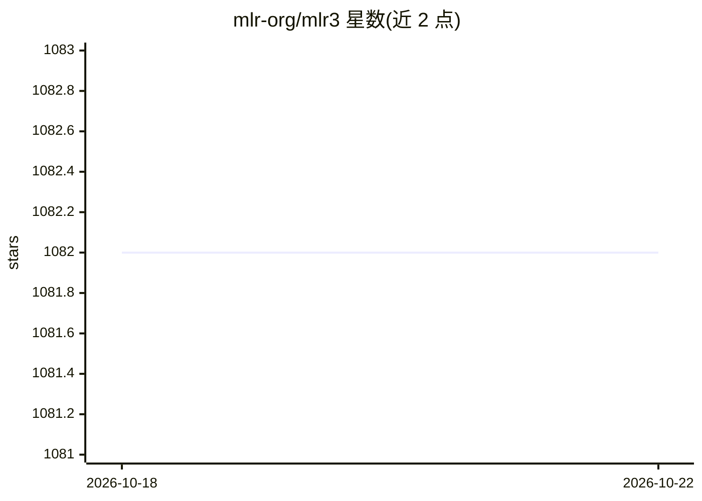

# mlr-org/mlr3

⭐ 1,082 · R · LGPL-3.0 · 推送 2026-10-21 · [GitHub](https://github.com/mlr-org/mlr3) · [官网](https://mlr3.mlr-org.com) · 组织维护

**R 语言面向对象机器学习框架，mlr 的继任者**

mlr-org 团队维护的 R 机器学习框架，提供任务、学习器、重采样、基准评测等基础构建块，支持回归、分类与生存分析，核心学习器由扩展包 mlr3learners 与 mlr3extralearners 提供。采用 R6 面向对象设计与 data.table 计算，运行时依赖较少；通过 future 抽象支持并行后端完成重采样与基准实验并行化。配套书籍、速查表、教程视频与 I2ML 课程资源。可作为 mlr3verse 元包的一部分安装。

## 筛选速览

| 维度 | 判定 | 备注 |
|---|---|---|
| AI 角色 | `ai-native` | 本体是模型或模型工具 |
| 许可风险 | `viral` | LGPL-3.0 |
| 部署形态 | `None` |  |
| 模型依赖 | — | README 未给出锁定关系 |
| 硬件要求 | — | 无带数字的原话,不猜 |
| 安装摩擦 | `low` | 无编译、无系统依赖或容器化 |
| 成熟度 | — | 结构信号不足 |

## 能力要点

- 覆盖任务构建、训练预测、重采样与基准评测的 ML 基础构建块
- R6 + data.table 的面向对象设计与低依赖策略
- 通过 future 抽象支持多并行后端的重采样/基准实验
- 扩展包生态（mlr3learners/mlr3pipelines/mlr3tuning 等）与配套书籍课程

## 适用场景

- 在 R 中做分类/回归任务的训练、评估与交叉验证
- 组织可复现的机器学习工作流与基准实验
- 教学场景：I2ML 课程演示与练习使用

## 场景标签

`模型评测` · 领域:评测与运维

## 证据(README 行号)

> L6: Efficient, object-oriented programming on the building blocks of machine
> L25:  - Recommended core regression, classification, and survival learners
> L111: learner = lrn("classif.rpart", cp = .01)

## 星数曲线

2026-10-18 1,082 → 2026-10-22 1,082（+0）

---
*卡片 v1 · prompt 1.4 · 生成 2026-10-21 · 置信度 high · 依据 README sha `26a5cb81558d` · [字段定义](../../DATASET.md)*
