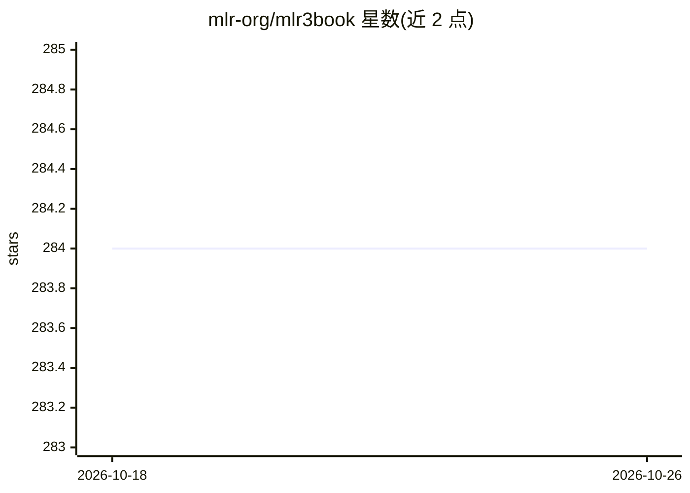

# mlr-org/mlr3book

⭐ 284 · TeX · NOASSERTION · 推送 2026-10-10 · [GitHub](https://github.com/mlr-org/mlr3book) · [官网](https://mlr3book.mlr-org.com/) · 组织维护

**mlr3 机器学习框架的免费在线书籍构建仓库**

存储《Applied Machine Learning Using mlr3 in R》（Bischl 等，2024，CRC Press 出版）的免费在线版本源码，使用 Quarto 构建并可渲染为 HTML 或 PDF 阅读。纸质版售卖收益归 mlr 组织用于 mlr 生态的维护与开发。仓库同时是社区贡献入口，通过 CONTRIBUTING.md 说明参与方式，并链接 StackOverflow 与 Mattermost 社区渠道。面向使用 R 做 machine learning 的读者与 mlr3 用户。

## 筛选速览

| 维度 | 判定 | 备注 |
|---|---|---|
| AI 角色 | `ai-knowledge` | 知识聚合/清单类 |
| 许可风险 | `none` | NOASSERTION |
| 部署形态 | `None` |  |
| 模型依赖 | — | README 未给出锁定关系 |
| 硬件要求 | — | 无带数字的原话,不猜 |
| 安装摩擦 | `low` | 无编译、无系统依赖或容器化 |
| 成熟度 | — | 结构信号不足 |

## 能力要点

- 《Applied Machine Learning Using mlr3 in R》免费在线版源码仓库
- 使用 Quarto 构建，提供 HTML 与 PDF 渲染版本
- 纸质版收益用于 mlr 组织维护 mlr 生态

## 适用场景

- 系统学习 mlr3 框架的机器学习建模方法
- 查阅 mlr3 各模块的用法与示例
- 通过提交 issue/PR 参与书籍内容贡献

## 场景标签

`教程课程` · 领域:学习与行业

## 证据(README 行号)

> L7: Repository to build the free, online version of *Applied Machine Learning Using mlr3 in R* using quarto.

## 星数曲线

2026-10-18 284 → 2026-10-26 284（+0）

---
*卡片 v1 · prompt 1.4 · 生成 2026-10-22 · 置信度 high · 依据 README sha `4e8fde84b62e` · [字段定义](../../DATASET.md)*
