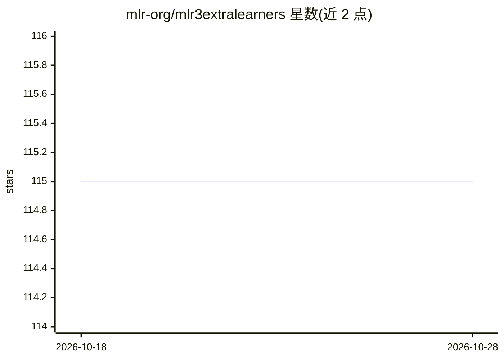

# mlr-org/mlr3extralearners

⭐ 115 · R · LGPL-3.0 · 推送 2026-10-28 · [GitHub](https://github.com/mlr-org/mlr3extralearners) · [官网](https://mlr3extralearners.mlr-org.com/) · 组织维护

**为 mlr3 机器学习框架提供扩展学习器的 R 包**

mlr3extralearners 收录 mlr3 生态中未被 mlr3learners 及核心包包含的额外学习器（Learner），供使用 mlr3 框架做机器学习建模的用户扩展可选算法。包内置检测学习器依赖是否已安装的功能，并提供 install_learner 函数自动安装学习器所需的依赖包。仅通过 GitHub 或 r-universe 仓库安装，不上架 CRAN；提供添加新学习器的扩展教程，并有对应 JOSS 论文可引用。

## 筛选速览

| 维度 | 判定 | 备注 |
|---|---|---|
| AI 角色 | `ai-ecosystem` | LLM/agent 周边工具 |
| 许可风险 | `viral` | LGPL-3.0 |
| 部署形态 | `None` |  |
| 模型依赖 | — | README 未给出锁定关系 |
| 硬件要求 | — | 无带数字的原话,不猜 |
| 安装摩擦 | `low` | 无编译、无系统依赖或容器化 |
| 成熟度 | — | 结构信号不足 |

## 能力要点

- 收录 mlr3learners 与核心包之外的所有 mlr3 学习器
- install_learner 函数自动安装学习器依赖包
- 可检测学习器所需包是否已安装
- 提供添加新学习器的扩展教程

## 适用场景

- 在 mlr3 中使用核心包未收录的回归/分类学习器（如 gbm）
- 自动补齐某个学习器的 R 包依赖
- 为 mlr3 生态贡献新的学习器实现

## 场景标签

 · 领域:机器学习/R 生态

## 证据(README 行号)

> L16: `mlr3extralearners` contains all learners from mlr3 that are not in
> L17: `mlr3learners` or the core packages. An overview of all learners within

## 星数曲线

2026-10-18 115 → 2026-10-28 115（+0）

---
*卡片 v1 · prompt 1.4 · 生成 2026-10-23 · 置信度 high · 依据 README sha `edb1e48e4854` · [字段定义](../../DATASET.md)*
