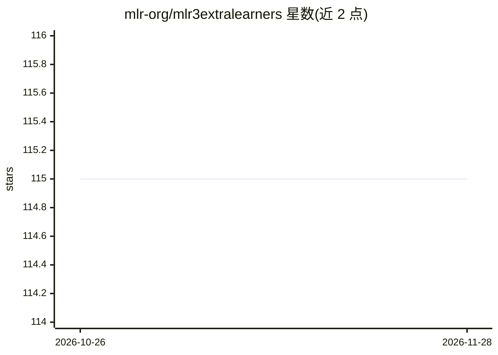

# mlr-org/mlr3extralearners

⭐ 115 · R · LGPL-3.0 · 推送 2026-11-20 · [GitHub](https://github.com/mlr-org/mlr3extralearners) · [官网](https://mlr3extralearners.mlr-org.com/) · 组织维护

**mlr3 的额外机器学习学习器集合，供 R 用户扩展模型种类**

收录 mlr3 生态中不属于核心包与 mlr3learners 的全部学习器，统一以 lrn() 接口调用；内置检测所需依赖包是否安装的机制，并提供 install_learner 函数安装学习器所需依赖。包通过 GitHub 与 r-universe 分发，不在 CRAN 上。支持社区贡献新学习器，仓库附有供 AI 编码代理使用的 mlr3-add-learner 技能，并随 Mathematical Research Data Initiative 开发。

## 筛选速览

| 维度 | 判定 | 备注 |
|---|---|---|
| AI 角色 | `ai-native` | 本体是模型或模型工具 |
| 许可风险 | `viral` | LGPL-3.0 |
| 部署形态 | `None` |  |
| 模型依赖 | — | README 未给出锁定关系 |
| 硬件要求 | — | 无带数字的原话,不猜 |
| 安装摩擦 | `low` | 无编译、无系统依赖或容器化 |
| 成熟度 | — | 结构信号不足 |

## 能力要点

- 集中收录 mlr3 生态核心包之外的额外学习器
- 检测学习器所需依赖包缺失并提示
- install_learner 函数一键安装学习器依赖
- 提供 Claude Code 可自动拾取的添加学习器 agent 技能

## 适用场景

- 在 mlr3 管线中使用 gbm 等额外学习器训练与预测
- 为自维护的建模包接入 mlr3 学习器接口
- 统一管理多个学习器的依赖包安装

## 场景标签

 · 领域:机器学习/R 统计建模

## 证据(README 行号)

> L6: Extra Learners for **mlr3**.
> L16: `mlr3extralearners` contains all learners from mlr3 that are not in
> L60: The package includes functionality for detecting if you have the

## 星数曲线

2026-10-26 115 → 2026-11-28 115（+0）

---
*卡片 v1 · prompt 1.4 · 生成 2026-11-28 · 置信度 high · 依据 README sha `a3fda17f6a23` · [字段定义](../../DATASET.md)*
