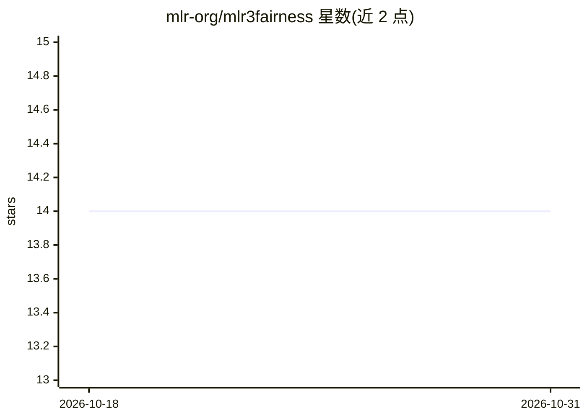

# mlr-org/mlr3fairness

⭐ 14 · HTML · LGPL-3.0 · 推送 2026-04-24 · [GitHub](https://github.com/mlr-org/mlr3fairness) · [官网](https://mlr3fairness.mlr-org.com) · 组织维护

**mlr3 的机器学习公平性扩展：审计、可视化与去偏**

R 语言 mlr3 生态的公平性扩展包，面向使用 mlr3 的机器学习从业者与研究者：通过 fairness.* 前缀指标（组间差异类指标、约束精度指标）审计 mlr3 学习器，提供准确率-公平性权衡等可视化，包含去偏方法（EOd、reweighing，可与 mlr3pipelines 组合）、直接学习公平模型的 fairml 学习器、adult/compas 数据集及 Model Card/Datasheet 的 RMarkdown 报告模板。README 明确提示：仅基于观测数据的审计与去偏不能保证决策系统公平。

## 筛选速览

| 维度 | 判定 | 备注 |
|---|---|---|
| AI 角色 | `ai-ecosystem` | LLM/agent 周边工具 |
| 许可风险 | `viral` | LGPL-3.0 |
| 部署形态 | `None` |  |
| 模型依赖 | — | README 未给出锁定关系 |
| 硬件要求 | — | 无带数字的原话,不猜 |
| 安装摩擦 | `low` | 无编译、无系统依赖或容器化 |
| 成熟度 | — | 结构信号不足 |

## 能力要点

- fairness.* 系列组间差异指标（fpr/tpr/eod/demographic parity 等）并支持自定义
- 去偏方法（EOd、reweighing_os/wts）可与 mlr3pipelines 组合使用
- 内嵌 fairml 公平学习器与 adult/compas 两个公平性数据集
- Model Card / Datasheet / 公平性报告的 RMarkdown 模板

## 适用场景

- 审计 mlr3 训练的模型在不同受保护群体上的指标差异
- 通过重加权等管道方法改善模型公平性
- 为模型与数据集生成公平性文档报告

## 场景标签

`模型评测` · 领域:评测与运维

## 证据(README 行号)

> L32: The **goal of `mlr3fairness`** is to allow for auditing of `mlr3`
> L33: learners, visualization and subsequently trying to improve fairness

## 星数曲线

2026-10-18 14 → 2026-10-31 14（+0）

---
*卡片 v1 · prompt 1.4 · 生成 2026-10-31 · 置信度 high · 依据 README sha `dd58099950ab` · [字段定义](../../DATASET.md)*
