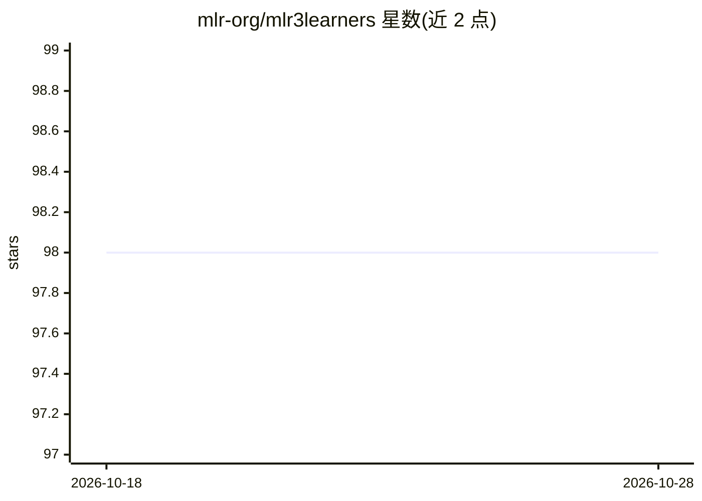

# mlr-org/mlr3learners

⭐ 98 · R · LGPL-3.0 · 推送 2026-10-28 · [GitHub](https://github.com/mlr-org/mlr3learners) · [官网](https://mlr3learners.mlr-org.com) · 组织维护

**为 mlr3 提供推荐机器学习学习器的 R 包**

mlr-org 团队维护的 R 包，为 mlr3 机器学习框架提供一组常用学习器：分类方面含惩罚逻辑回归、kNN、LDA、朴素贝叶斯、随机森林（ranger）、SVM、XGBoost 等 11 种；回归方面含惩罚线性回归、Kriging、随机森林、SVM 等 9 种。各学习器依赖对应 R 包（glmnet、kknn、ranger、xgboost 等），可设 dependencies=TRUE 一并安装。更多学习器由 GitHub 上的 mlr3extralearners 包提供。

## 筛选速览

| 维度 | 判定 | 备注 |
|---|---|---|
| AI 角色 | `ai-ecosystem` | LLM/agent 周边工具 |
| 许可风险 | `viral` | LGPL-3.0 |
| 部署形态 | `None` |  |
| 模型依赖 | — | README 未给出锁定关系 |
| 硬件要求 | — | 无带数字的原话,不猜 |
| 安装摩擦 | `low` | 无编译、无系统依赖或容器化 |
| 成熟度 | — | 结构信号不足 |

## 能力要点

- 提供 11 个分类学习器与 9 个回归学习器
- 覆盖 glmnet、ranger、xgboost、SVM 等常用算法
- 支持 CRAN 稳定版与 pak 开发版两种安装途径

## 适用场景

- 在 mlr3 中直接调用常用的分类与回归算法
- 配合 mlr3 做基准建模时使用标准学习器集合
- 需要开发版时通过 pak 从 GitHub 安装

## 场景标签

 · 领域:机器学习/R 生态

## 证据(README 行号)

> L10: This package provides essential learners for mlr3, maintained by the mlr-org team.
> L11: Additional learners can be found in the mlr3extralearners package on GitHub.

## 星数曲线

2026-10-18 98 → 2026-10-28 98（+0）

---
*卡片 v1 · prompt 1.4 · 生成 2026-10-23 · 置信度 high · 依据 README sha `6acd9a3894ed` · [字段定义](../../DATASET.md)*
