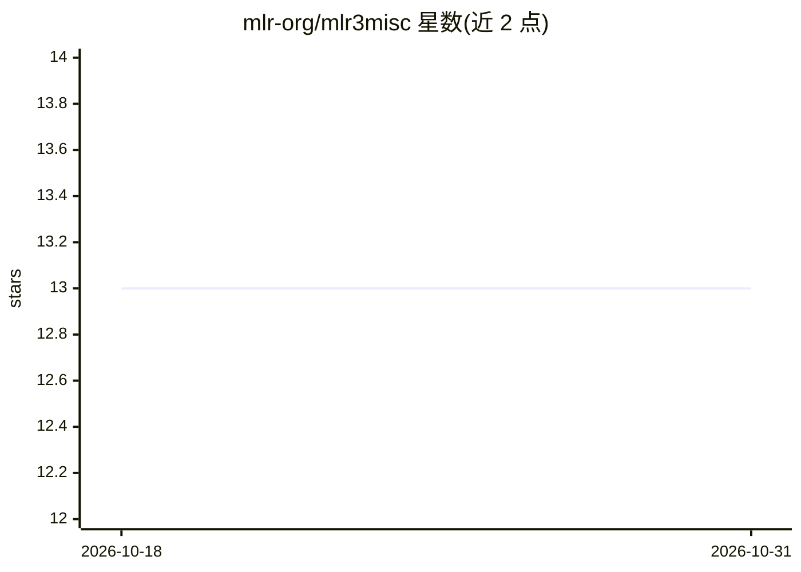

# mlr-org/mlr3misc

⭐ 13 · R · LGPL-3.0 · 推送 2026-10-30 · [GitHub](https://github.com/mlr-org/mlr3misc) · [官网](https://mlr3misc.mlr-org.com) · 组织维护

**mlr3 生态的 R 辅助函数工具包**

mlr-org 组织维护的 R 包，为 mlr3 机器学习框架系列提供杂项辅助函数。作为 mlr3 生态的基础依赖组件，不直接提供模型训练或预测功能。可通过 CRAN 安装发行版，或经 GitHub 安装开发版；项目提供包网站、CI 状态徽章与 Mattermost 社区入口。面向使用或开发 mlr3 系列包的 R 用户与开发者。

## 筛选速览

| 维度 | 判定 | 备注 |
|---|---|---|
| AI 角色 | `ai-ecosystem` | LLM/agent 周边工具 |
| 许可风险 | `viral` | LGPL-3.0 |
| 部署形态 | `None` |  |
| 模型依赖 | — | README 未给出锁定关系 |
| 硬件要求 | — | 无带数字的原话,不猜 |
| 安装摩擦 | `low` | 无编译、无系统依赖或容器化 |
| 成熟度 | — | 结构信号不足 |

## 能力要点

- 为 mlr3 框架系列提供杂项辅助函数
- 发布于 CRAN 并提供 GitHub 开发版安装
- 由 mlr-org 组织维护，配套包网站与 CI 检查

## 适用场景

- 使用 mlr3 系列包时作为依赖自动安装
- 为 mlr3 开发扩展包时复用其辅助函数

## 场景标签

 · 领域:机器学习/R 语言生态

## 证据(README 行号)

> L5: Miscellaneous helper functions for mlr3.
> L1: # mlr3misc

## 星数曲线

2026-10-18 13 → 2026-10-31 13（+0）

---
*卡片 v1 · prompt 1.4 · 生成 2026-10-31 · 置信度 high · 依据 README sha `6d5f2799f88a` · [字段定义](../../DATASET.md)*
