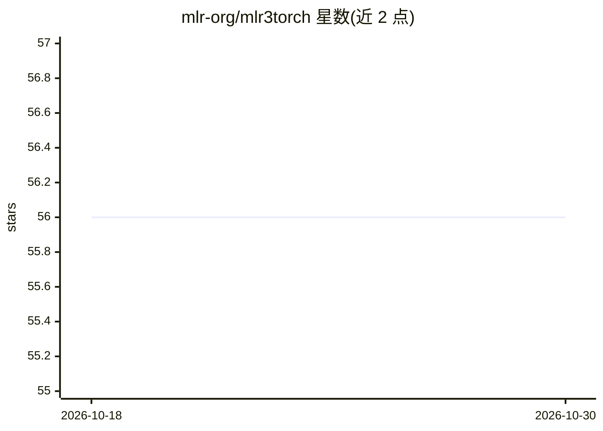

# mlr-org/mlr3torch

⭐ 56 · R · NOASSERTION · 推送 2026-10-29 · [GitHub](https://github.com/mlr-org/mlr3torch) · [官网](https://mlr3torch.mlr-org.com) · 组织维护

**R 语言的深度学习框架，基于 torch 并融入 mlr3 生态**

面向 mlr3 生态的 R 深度学习框架，构建在 torch 之上。提供现成 Learner（MLP 分类/回归、图像分类），也可用 mlr3pipelines 的 Graph 语言连接 PipeOpTorch 算子自定义网络架构，或直接定义 torch nn_module。支持 lazy_tensor 张量列存储多模态数据、回调定制训练循环、训练检查点与断点恢复，并接入 mlr3 的重采样、基准比较与 mlr3tuning 超参调优。需先安装 torch 运行时。当前生命周期标记为 experimental。

## 筛选速览

| 维度 | 判定 | 备注 |
|---|---|---|
| AI 角色 | `ai-native` | 本体是模型或模型工具 |
| 许可风险 | `none` | NOASSERTION |
| 部署形态 | `None` |  |
| 模型依赖 | — | README 未给出锁定关系 |
| 硬件要求 | — | 无带数字的原话,不猜 |
| 安装摩擦 | `low` | 无编译、无系统依赖或容器化 |
| 成熟度 | `idea` | |

## 能力要点

- 现成 Learner 覆盖表格分类/回归与图像分类
- 用 PipeOpTorch 算子与 Graph 语言自定义网络架构
- lazy_tensor 数据类型支持任意模态含多模态数据集
- 训练检查点/恢复及通过回调定制训练循环

## 适用场景

- 在 R 中用统一 mlr3 接口训练与评估深度学习模型
- 用 Graph 语言搭建自定义网络并接入超参调优
- 在表格特征旁存储张量以处理多模态数据

## 场景标签

 · 领域:机器学习/深度学习框架

## 证据(README 行号)

> L35: `mlr3torch` is a deep learning framework for the
> L37: `torch`. It makes it easy to build, train

## 星数曲线

2026-10-18 56 → 2026-10-30 56（+0）

---
*卡片 v1 · prompt 1.4 · 生成 2026-10-24 · 置信度 high · 依据 README sha `b3e5e04419f4` · [字段定义](../../DATASET.md)*
